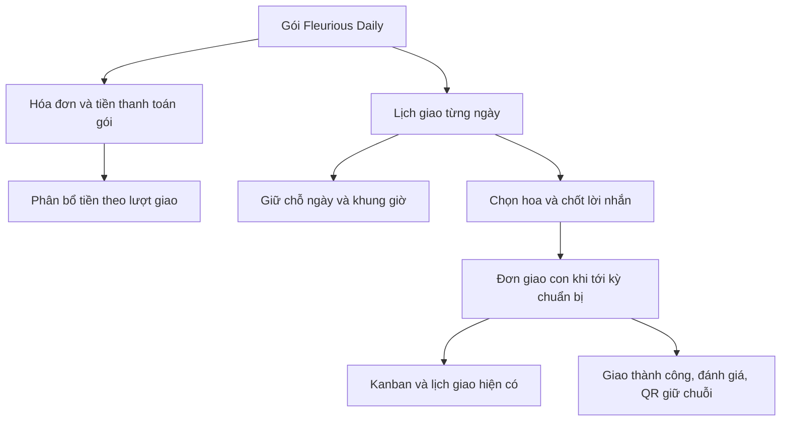

# Fleurious Daily — Kế hoạch đặt hoa theo lịch

Ngày nghiên cứu: 16/11/2026, múi giờ Hà Nội (`Asia/Ho_Chi_Minh`).

Phạm vi tài liệu gốc: nghiên cứu và thiết kế dựa trên mã nguồn Fleurious. Sau khi người dùng yêu cầu triển khai, đã bổ sung tính năng; xem [hướng dẫn vận hành và phạm vi thực tế](FLEURIOUS_DAILY_OPERATIONS.vi.md). Vercel chạy migration trước khi build. Giá và các mốc cấu hình bên dưới là ví dụ để đánh giá; chương trình mặc định chưa mở bán để cửa hàng cấu hình bộ hoa và chi phí thực.

## 1. Định vị và tên gọi

Tên đề xuất: **Fleurious Daily**. Nhãn menu tiếng Việt: **Hoa mỗi ngày**. Slogan: **Mỗi ngày, một lời thương.** CTA: **Hẹn lịch hoa**.

Khách đặt và thanh toán một lần, nhận một bó hoa trong mỗi ngày đã chọn, quản lý từng lượt giao và lời nhắn tại một lịch chung. Đây là gói hoa có thời hạn và nghĩa vụ giao cụ thể. Giai đoạn đầu không tự gia hạn hoặc tự trích tiền tháng kế tiếp; khi gần hết gói, khách chủ động mua lại.

Một số tên thay thế: Daily Bloom by Fleurious; Lịch hoa Fleurious; Một tháng nở hoa. Các tên này mới là ý tưởng, chưa kiểm tra khả năng đăng ký nhãn hiệu/tên miền.

Không dùng “Những ngày có hoa” làm tên chính vì hệ thống đang dùng ngôn ngữ này cho giữ chuỗi; lịch giao Daily và lịch kích hoạt chuỗi cần được phân biệt rõ.

## 2. Nghiên cứu và điều nên áp dụng

| Nguồn chính thức | Quan sát | Đề xuất cho Fleurious |
| --- | --- | --- |
| [Bloom & Wild](https://www.bloomandwild.com/help/subscriptions/what-is-a-subscription) | Có gói trả trước hữu hạn và gói thanh toán theo lần; hỗ trợ quản lý lịch | Ra mắt bằng gói trả trước, khách nhìn thấy toàn bộ ngày sẽ nhận hoa |
| [Bouqs](https://bouqs.com/subscriptions) | Cho tự chọn hoặc để cửa hàng chọn hoa; quản lý từng lượt giao | Hai cách chọn hoa cùng dùng một lịch và một cơ chế thanh toán |
| [Freddie’s Flowers](https://www.freddiesflowers.com/flower-subscriptions) | Cho quản lý lịch, bỏ lượt hoặc tạm dừng | Cần có tạm nghỉ/đổi ngày thay vì bắt khách nhận đủ bất chấp lịch cá nhân |
| [Điều kiện Freddie’s](https://www.freddiesflowers.com/terms-and-conditions) | Việc đổi lịch có hạn chốt trước khi chuẩn bị | Mỗi lượt hiển thị thời điểm cuối được sửa, gắn với hoạt động chuẩn bị thật của cửa hàng |

Đây chủ yếu là mô hình giao tuần/tháng ở thị trường khác. Đề xuất giao mỗi ngày tại Hà Nội là phương án riêng cho Fleurious, cần thử nghiệm chi phí và công suất thực tế; không suy rằng miễn phí giao hàng ở các website trên cũng có lợi nhuận tại Fleurious.

## 3. Lựa chọn sản phẩm và phạm vi ra mắt

### 3.1. Cách chọn lịch

1. **Chọn ngày nhận:** khách tick từng ngày, ví dụ 10 ngày không liên tiếp. Một ngày nhận một bó trong một khung giờ.
2. **Nhận cả tháng:** chọn tháng dương lịch; hệ thống đếm đúng 28/29/30/31 ngày. Tháng đang diễn ra chỉ chọn các ngày tương lai còn đủ thời gian chuẩn bị.
3. Preset giúp chọn nhanh: tất cả ngày, thứ Hai–thứ Sáu, ngày cách ngày, xóa lựa chọn. “Ngày làm việc” thực tế có thể là 20/21/22/23 lượt, không mặc định 20.

Gói 10/20/30 là mốc **số lượt giao**, không phải số ngày liên tiếp và không phải nhãn tháng cố định. UI luôn ghi rõ ngày bắt đầu, kết thúc và tổng lượt. Không biến “cả tháng” thành 30 ngày nếu tháng có 31 ngày.

Ngày nghỉ, ngày ngừng giao, slot đầy phải thể hiện ngay trên lịch. Nếu có ngày không phục vụ, yêu cầu khách chọn lịch khác hoặc chấp nhận lịch còn lại và giá mới; không âm thầm bỏ ngày rồi vẫn quảng cáo nhận mỗi ngày.

Mặc định đề xuất: tối đa 31 lượt/gói, bán lịch trước tối đa 90 ngày, ngày giao đầu cách lúc mua ít nhất 48 giờ. Các giới hạn này admin điều chỉnh được. Không có hai lượt trùng ngày trong cùng gói ở MVP.

### 3.2. Hai cách chọn hoa

| Tiêu chí | Tôi tự chọn | Fleurious chọn giúp |
| --- | --- | --- |
| Trải nghiệm | Chọn mẫu thuộc bộ Daily cho từng ngày; áp dụng một mẫu cho nhiều ngày rồi sửa nhanh | Chọn ngân sách, phong cách, màu yêu thích, loài cần tránh và mức độ bất ngờ |
| Giá | Có giá Daily riêng theo mẫu; premium thêm tiền rõ ràng | Giá bó cơ bản theo ngân sách đã mua |
| Cam kết | Đúng mẫu hoặc quy trình xin thay thế đã thỏa thuận | Đúng tiêu chuẩn gói, phong cách và các giới hạn đã chọn; mẫu có thể theo mùa |
| Vận hành | Cửa hàng biết nhu cầu nguyên liệu từng mẫu sớm | Cửa hàng tối ưu được nguyên liệu theo ngày và mùa |
| Khi thiếu nguyên liệu | Gợi ý mẫu tương đương, xin khách chọn hoặc xử lý đổi ngày/hoàn phần chưa giao | Nhân viên chọn từ ứng viên hợp lệ; không có ứng viên thì báo cần xử lý |

**Nên có cả hai từ phiên bản đầu**, vì phù hợp hai nhóm nhu cầu khác nhau. Khách cũng có thể cho phép cửa hàng chọn giúp những ngày chưa tự chọn; quyền này phải được bật rõ ràng.

Ngân sách **70.000đ/bó/ngày** nên là dòng mini bouquet/Daily riêng với quy cách minh họa rõ. Không lấy tùy ý mẫu bán lẻ giá cao hiện có rồi hứa cung cấp ở mức 70.000đ. Admin cấu hình danh sách mẫu/size hợp lệ, hình ảnh tham khảo, quy cách, giá Daily, giá vốn ước tính và khả năng cung ứng theo ngày.

### 3.3. Chọn tự động có kiểm soát

- Dùng bộ quy tắc trước, chưa cần mô hình AI: ngân sách, ngày có thể cung ứng, phong cách, màu, danh sách loại trừ, giới hạn công suất và mẫu đã giao gần đây.
- Loại trừ cứng các loài khách không muốn; không có ứng viên phù hợp thì dừng ở “Cửa hàng đang chọn mẫu”, không tự bỏ giới hạn.
- Hạn chế lặp cùng mẫu trong 7 lượt gần nhất; đây là tiêu chí ưu tiên, không hứa 30 mẫu khác nhau khi bộ sưu tập không đủ lớn. Báo admin khi cần nới quy tắc, không tự sửa những điều khách cấm.
- Tạo phương án, cho nhân viên duyệt trong ngày chuẩn bị. Lưu phiên bản quy tắc, mẫu đã chọn và lý do thay thế để truy vết.
- Lịch xa hiển thị ảnh phong cách tham khảo; chỉ thể hiện ảnh mẫu chính xác sau khi mẫu đã được xác nhận. “Bất ngờ” có thể ẩn ảnh với người nhận nhưng người đặt vẫn quản lý được lựa chọn.
- Nếu mẫu có phụ thu, không tự tăng giá. Chỉ chốt khi khách đồng ý và thanh toán phụ thu hoặc chọn phương án nằm trong gói.

## 4. Giá gói, giảm giá và phí ship

### 4.1. Quy tắc giá đề xuất

Admin chỉnh giá bó cơ bản theo nhóm ngân sách và bảng mốc: từ bao nhiêu lượt, giảm bao nhiêu phần trăm. Mặc định áp dụng mức cao nhất đã đạt cho toàn bộ phần hoa cơ bản của gói. Không cộng dồn 5% + 8% + 10%.

Ví dụ **giả định**, chưa bao gồm ship/phụ thu:

| Lượt giao | Giảm | Tiền hoa/bó sau giảm | Tổng tiền hoa | Tiết kiệm tiền hoa |
| --- | --- | --- | --- | --- |
| 1–9 | 0% | 70.000đ | Theo số lượt | 0đ |
| 10 | 5% | 66.500đ | 665.000đ | 35.000đ |
| 20 | 8% | 64.400đ | 1.288.000đ | 112.000đ |
| 30 | 10% | 63.000đ | 1.890.000đ | 210.000đ |
| 31 | 10% | 63.000đ | 1.953.000đ | 217.000đ |

11–19 lượt hưởng mốc 10, 21–29 hưởng mốc 20; 31 hưởng mốc 30. Tháng 28 ngày ở cấu hình này hưởng mốc 20. Nếu muốn ưu đãi “đủ cả tháng” ngang mốc 30, admin cần bật quy tắc riêng công khai cho `FULL_CALENDAR_MONTH`; không giả số lượng thành 30. Giai đoạn đầu nên dùng một bảng mốc theo lượt cho dễ hiểu.

Phần phụ thu premium tách khỏi giá cơ bản và mặc định không được giảm theo mốc. Để dễ chọn, các mẫu cơ bản trong cùng nhóm Daily có giá gói bằng nhau; mẫu rẻ hơn ngoài nhóm không mặc nhiên biến phần ngân sách dư thành tiền rút được.

Tính bằng VND nguyên và phân bổ giảm giá tới từng lượt theo cách xác định, tổng khớp tuyệt đối với hóa đơn. Snapshot giá, mốc giảm, ưu đãi ship, phụ thu và điều khoản khi mua. Admin đổi cấu hình chỉ tác động báo giá/gói mới.

Validate cấu hình: mốc không trùng, phần trăm trong giới hạn, giá không âm; cảnh báo hoặc chặn cấu hình khiến thêm một lượt lại làm tổng tiền hoa giảm bất thường. Có công cụ xem thử gói 1–31 lượt trước khi publish.

### 4.2. Ưu đãi ship

Tái sử dụng phí gốc tính bằng Goong hiện có: quãng đường đường bộ, giá/km, phí tối thiểu/tối đa và bước làm tròn. Sau đó áp dụng ưu đãi Daily trên từng lượt, không thay hệ thống bằng “khu vực giao” cũ.

Các kiểu admin có thể chọn:

- Giảm theo phần trăm, có trần tiền hỗ trợ mỗi lượt.
- Hỗ trợ số tiền cố định mỗi lượt; khách trả phần còn lại.
- Miễn phí thực sự trong bán kính đường bộ được cấu hình; ngoài phạm vi áp dụng mức hỗ trợ khác hoặc không bán lịch Daily.

`ship_khách_trả = max(0, ship_gốc - hỗ_trợ_được_duyệt)`.

Chỉ hiển thị **“Miễn phí giao hàng”** nếu phí khách trả thực sự bằng 0. Nếu chỉ hỗ trợ tối đa 15.000đ, ghi đúng mức hỗ trợ, không gọi là free ship.

Ví dụ chính sách: gói 10 giảm 30% ship; gói 20 giảm 50%; gói từ 30 miễn ship trong 3 km, ngoài 3 km hỗ trợ tối đa 15.000đ/lượt. Đây là đề xuất để cửa hàng mô phỏng chi phí trước khi bán, không phải mức đã chứng minh có lợi nhuận.

Giả sử cùng địa chỉ có phí gốc 20.000đ/lượt và thỏa điều kiện ưu đãi:

| Gói | Tiền hoa | Ship khách trả cả gói | Tổng |
| --- | --- | --- | --- |
| 10 lượt | 665.000đ | 140.000đ | 805.000đ |
| 20 lượt | 1.288.000đ | 200.000đ | 1.488.000đ |
| 30 lượt, đủ điều kiện miễn ship | 1.890.000đ | 0đ | 1.890.000đ |

Giới hạn hỗ trợ theo lượt và ngân sách chiến dịch phải được giữ chỗ khi thanh toán. Không bán với cam kết miễn ship rồi dừng hỗ trợ giữa gói vì hết ngân sách.

Một địa chỉ dùng nhiều ngày không cần gọi Goong 31 lần để nhận cùng một quãng đường. Tôn trọng cấu hình lưu cache hiện có và thời hạn dữ liệu của nhà cung cấp; snapshot phí và phiên bản chính sách trên gói đã thanh toán. Không tái dùng `ShippingQuote` có TTL ngắn như một chứng từ còn hiệu lực sau nhiều tuần.

### 4.3. Kiểm tra khả năng sinh lời

Cho admin nhập giá vốn, đóng gói/thiệp, công bó, chi phí ship ước tính, chi phí giao lỗi và tỷ lệ hao hụt. Báo lãi đóng góp ước tính theo từng lượt và toàn gói:

`lãi_đóng_góp = tiền_hoa_thu + tiền_ship_thu + phụ_thu_thu - giá_vốn_hoa - công_bó - bao_bì/thiệp - chi_phí_ship_thực - chi_phí_biến_đổi_khác`.

Không trừ tiền hỗ trợ ship thêm lần nữa nếu đã tính toàn bộ phí giao thực trong công thức. Cảnh báo biên thấp; manager/owner mới được phê duyệt mức dưới sàn. Số 70.000đ phải được thử với quy cách bó và tuyến giao thực, vì giảm tiền hoa cùng free ship dễ ăn hết biên lợi nhuận.

## 5. Trải nghiệm client mobile/PWA

### 5.1. Luồng mua

Trang `/daily` giới thiệu bằng hình, ví dụ lịch và giá “từ”; đủ ba ý: chọn ngày, chọn hoa, thêm lời thương.

Wizard `/daily/create` gồm 5 bước:

1. **Lịch nhận:** chọn ngày/tháng, preset, số lượt và khung giờ. Chọn nhanh một slot cho cả lịch, có thể sửa từng ngày nếu còn chỗ.
2. **Hoa của bạn:** tự chọn hoặc Fleurious chọn giúp, nhóm ngân sách, tùy chọn phong cách, mẫu cần tránh.
3. **Người nhận:** một người và một địa chỉ mặc định/gói ở MVP, gợi ý Goong, chỉ dẫn giao và chế độ quà bất ngờ.
4. **Lời thương:** chọn thư viện tự động hoặc tự viết từng ngày; tiếp tục hỗ trợ thiệp tự động/thiệp tay. Thiệp tay bỏ trống nội dung in, nhân viên xem nội dung cần chép ở phiếu việc riêng.
5. **Kiểm tra và thanh toán:** toàn bộ lịch, tiền hoa, mức giảm, ship trước/sau ưu đãi, phụ thu, hạn sửa, điều kiện đổi/hủy. Đăng nhập trước khi thanh toán để quản lý lịch lâu dài.

Giá tự tính khi thay lịch, mẫu hoặc địa chỉ, có trạng thái đang tính và xử lý kết quả đến muộn; không có nút “kiểm tra tổng tiền”. Máy chủ là nơi quyết định giá/công suất, không tin giá từ client. Nháp có thể lưu; khi mở lại cần xác nhận giá và chỗ còn lại.

Mobile có thanh tổng tiền và CTA gọn, không che safe area/PWA nav. Màu Burgundy `#6e1423`, nền `#f4eade`, button glass đồng bộ. Ô lịch đủ lớn để chạm, có trạng thái bằng chữ ngoài màu; giảm chuyển động theo tùy chọn thiết bị. Animation chuyển bước nhẹ, không làm thay đổi chiều cao bất ngờ.

### 5.2. Quản lý sau mua

`/account/daily`: các gói, số lượt đã giao/còn lại, ngày tiếp theo, trạng thái và cảnh báo cần làm.

`/account/daily/[id]`: mobile ưu tiên danh sách “Sắp tới” và calendar; desktop lịch và panel chi tiết cạnh nhau. Ô ngày có ngày nhận, ảnh nhỏ hoặc ảnh phong cách tham khảo, trạng thái và dấu có lời nhắn. Bấm ngày mở bottom sheet trên mobile.

Panel lượt giao có: hoa, thời gian, lời nhắn, hạn sửa, phần tiền đã phân bổ, tiến trình đơn và các thao tác hợp lệ. Hiển thị “Bạn còn có thể sửa tới 18:00 ngày 19/11” rõ hơn chỉ đếm ngược.

Lượt chưa tới chưa có Order vẫn hiện đầy đủ như một lịch hẹn. Khi Order được tạo, mở trang chi tiết đơn hiện có. Lịch Daily dùng icon lịch/giao hàng; không tự gắn icon lửa hoặc coi đã giữ chuỗi.

Người đặt kiểm soát thanh toán và lời nhắn; người nhận chỉ nhận thông tin giao cần thiết. Chế độ quà bất ngờ không gửi ảnh/lời nhắn trước cho người nhận. Không để public tracking của một mã gói làm lộ toàn bộ lịch, địa chỉ hoặc nội dung thiệp.

## 6. Lời chúc và hạn chỉnh sửa

- Thư viện lời chúc do admin duyệt, theo chủ đề: tự chăm sóc, tình yêu, gia đình, bạn bè, công việc. Chuẩn bị ít nhất 31 câu phù hợp/chủ đề trước khi hứa không lặp trong một gói.
- Lưu sẵn lời chúc từng ngày khi khách xác nhận lịch; khách xem, thay hoặc chọn không gửi. Không thay đổi ngẫu nhiên mỗi lần mở trang.
- Có chọn xưng hô, tên nhận/gửi, xem trước thiệp và áp dụng một lời nhắn cho nhiều ngày; cảnh báo trùng nhẹ, vẫn cho phép khách chủ động lặp.
- Giai đoạn đầu dùng template có kiểm duyệt, chưa cần thêm chi phí API AI. Nếu bổ sung AI sau, nội dung cần được lưu, cho xem trước và có fallback; không suy diễn sự kiện riêng tư.
- Mặc định hạn sửa mẫu/ngày/slot: 18:00 ngày trước giao; lần đầu cần ít nhất 48 giờ. Admin cấu hình riêng hạn sửa lời nhắn và ngày cao điểm. Khi chốt thực tế có thể sớm hơn do công đoạn chuẩn bị, UI phải phản ánh mốc đang hiệu lực.
- Lời nhắn được cập nhật theo `version`; sửa đồng thời không ghi đè im lặng. Nếu phiếu đã in trước hạn, tạo việc in lại; sau khóa không tự sửa bản thiệp đã chốt. Tên file/cache render phải theo phiên bản nội dung.
- Nhắc “Bạn có thể thêm lời nhắn cho ngày mai” trước hạn; không chặn giao nếu khách không sửa và đã chọn mặc định.

## 7. Tạm nghỉ, đổi ngày và ngoại lệ

| Tình huống | Xử lý đề xuất |
| --- | --- |
| Đổi ngày/slot trước hạn | Chọn slot còn chỗ; chuyển giữ chỗ trong một transaction; giữ giá hoa của lượt |
| Tạm nghỉ | Chọn các ngày muốn nghỉ rồi đề xuất lịch bù; không tự đoán ngày quay lại |
| Bỏ lượt chưa chọn ngày bù | Lượt ở trạng thái chờ xếp lịch, chưa sinh đơn; công bố hạn sử dụng và nhắc trước hạn |
| Yêu cầu sau hạn hoặc đã chuẩn bị | Hiển thị liên hệ cửa hàng; nhân viên quyết định theo công đoạn thực tế và điều khoản đã chấp nhận |
| Đổi địa chỉ | MVP giữ một địa chỉ/gói; thay địa chỉ qua hỗ trợ hoặc luồng có báo giá lại cho các lượt chưa khóa, tuyệt đối không sửa đơn đã giao |
| Thiếu hoa đúng mẫu | Xin chọn mẫu tương đương/đổi ngày/hoàn giá trị lượt; không nâng tiền tự động |
| Shop nghỉ đột xuất, thiên tai hoặc không thể giao | Cảnh báo vận hành, thống nhất lịch bù hoặc hoàn phần không cung cấp; không đánh dấu đã giao để đóng việc |
| Khách vắng mặt | Ghi từng lần giao, liên hệ, thỏa thuận giao lại; phí phát sinh chỉ khi được công bố và chấp nhận |
| Cron ngừng vài giờ/ngày | Quét việc quá hạn chưa xử lý; nếu đã trễ giờ giao thì đưa ngoại lệ cho admin, không tạo “đơn đã giao” bù |

Đề xuất cho lịch bù: tối đa 15 ngày sau ngày kết thúc ban đầu, admin chỉnh được. Đây là giới hạn vận hành đề xuất cần công bố rõ; khi chưa xếp được ngày bù hoặc do lỗi shop, có phương án hỗ trợ/hoàn phần chưa thực hiện, không âm thầm xóa tiền đã trả.

Đổi ngày không giảm số lượt đã mua nên không mất mức ưu đãi. Thêm lượt/premium là yêu cầu thay đổi có báo giá và hóa đơn bổ sung; không viết lại giá các lượt đã giao.

Nếu hủy phần chưa giao trước hạn: hoàn đúng số tiền ròng đã phân bổ cho phần đó. Khuyến nghị không hồi tố tăng giá những bó đã giao; quản lý biên lợi nhuận bằng cấu hình ban đầu và theo dõi tỷ lệ hủy. Phần đã khóa/đã chuẩn bị phải xử lý theo quy định đã hiển thị, có lý do và phê duyệt; không tự phát sinh phí phạt ẩn.

## 8. Kiến trúc gói cha và đơn giao con

Không tạo 30 đơn checkout thông thường ngay khi mua: hiện tại `createOrderTx` giữ tồn kho, slot, quota hội viên và thời hạn thanh toán cho từng Order. Dùng nguyên luồng này cho cả tháng dễ khóa kho hiện tại và tính tiền/quyền lợi lặp.

Đề xuất cấu trúc:

- Tạo toàn bộ `DailyDelivery` ngay khi xác nhận lịch. Chỉ tạo Order trong khoảng chuẩn bị, mặc định tại mốc khóa D-1; không gọi API công khai để tạo đơn thay cho service nội bộ.
- Công suất ngày/slot phải được kiểm tra và đặt chỗ cho toàn lịch khi mua. Trong lúc chờ tiền, giữ tạm có TTL, đề xuất 15 phút cho checkout Daily; khi hết hạn giải phóng đúng một lần. Không tự kế thừa hạn giữ 24 giờ của đơn kênh ngoài nếu chưa có chính sách Daily tương ứng.
- Phân biệt giữ chỗ năng lực tương lai với giữ tồn kho hiện tại. Lịch tự chọn cần thêm hạn mức cung ứng theo ngày/mẫu hoặc nhóm nguyên liệu; không được coi tồn kho hiện tại là lời bảo đảm cung ứng tháng sau.
- Khi tới kỳ chuẩn bị, kiểm tra mẫu/nguồn cung, giữ tồn kho phù hợp, tạo Order đúng một lần và liên kết lịch. Nếu thiếu, tạo ngoại lệ để shop xử lý, không lặng lẽ bỏ ngày.
- Một đặt chỗ ngày/slot chỉ bị tính một lần. Khi sinh Order con phải chuyển quyền sử dụng reservation hiện có, không chạy thêm `SlotBooking.count + 1` như đơn mới.
- Dùng khóa/transaction theo thứ tự nhất quán, unique `DailyDelivery.orderId` và idempotency theo `deliveryId`, optimistic version cho sửa lịch. Kể cả webhook, cron và admin chạy đồng thời cũng không sinh hai đơn.

Đơn con được thanh toán bằng nguồn tiền gói, không tạo thêm yêu cầu chuyển khoản hoặc công nợ COD. Đề xuất nguồn nội bộ `DAILY_PLAN` và phương thức nội bộ `PREPAID_PLAN`; chỉ service tin cậy được tạo loại này. Sau khi đủ tiền và tới kỳ chuẩn bị, Order được đưa vào **Chờ chuẩn bị** theo workflow hiện có. Các lượt xa chưa có Order chỉ nằm trong lịch Daily/dự báo, tránh tràn Kanban hôm nay.

## 9. Thanh toán SePay, phân bổ và hoàn tiền

1. Server tạo báo giá có phiên bản và hạn hiệu lực, kiểm tra toàn bộ ngày/slot, rồi giữ tạm chỗ và hỗ trợ ship.
2. Tạo hóa đơn gói với mã thanh toán riêng, đề xuất tiền tố `FLD`; khách chuyển khoản một lần. QR là thông tin chuyển khoản; hết hạn QR trên UI không thể ngăn ngân hàng nhận tiền.
3. Webhook xác thực và ghi nhận giao dịch bền vững, kiểm mã/tài khoản/số tiền/thời hạn. Kích hoạt gói và xác nhận giữ chỗ trong transaction. Thiếu/thừa tiền hoặc trả muộn sau giải phóng chỗ vào đối soát; không tự chuyển ngày giao hoặc giao gói thiếu tiền.
4. Hóa đơn bổ sung cho premium/địa chỉ/lượt thêm có mã và số tiền riêng. Phần đã mua vẫn chạy nếu thay đổi chưa thanh toán; không dùng một yêu cầu nâng cấp để treo toàn gói.
5. Sổ phân bổ xác định mỗi lượt đã được tài trợ bao nhiêu cho hoa, ship và phần thêm. Order con chỉ dùng khoản đã phân bổ, không tạo dòng thu ngân hàng giả.
6. Refund khóa số tiền có thể hoàn và các lượt bị ảnh hưởng; lưu tham chiếu ngân hàng. Trạng thái hoàn tất chỉ sau xác nhận chuyển tiền thực hoặc API hoàn tiền được tích hợp, không giả định webhook tiền vào tự hoàn được.

Theo [tài liệu SePay](https://docs.sepay.vn/tich-hop-webhooks.html), webhook có thể trùng và cần chống lặp theo ID; cần đối soát bổ sung khi thông báo bị gián đoạn. Tái sử dụng cơ chế identity/hash, xác thực và đối soát sẵn có.

**Điểm sửa bắt buộc trong code hiện tại:** bộ nhận tiền và đối soát đang nhận mã `FLR`/`FLM`; phải mở rộng cả hai cho Daily. Bổ sung kiểm tra hóa đơn Daily chưa trả khi đổi tài khoản nhận tiền trong settings. Không chỉ thêm màn QR mà quên phân luồng giao dịch.

Quy tắc báo cáo:

- Tiền thu: tính một lần từ hóa đơn/giao dịch gói.
- Giá trị dịch vụ đã thực hiện: tính từ phần tiền ròng phân bổ cho các lượt đã giao, có trừ hoàn tiền tương ứng.
- Giá trị còn phải giao và tiền chờ hoàn được báo riêng; không cộng gói cha và 30 Order con thành hai lần doanh số.
- Google Analytics purchase của lần mua gói chỉ gửi một lần theo consent; lượt giao dùng event vận hành khác, không gửi lại cùng số tiền mua 30 lần.
- Bất biến kiểm thử: tổng phân bổ bằng số tiền được tài trợ; tiền đã thu được phân thành phần đã thực hiện, phần còn khả dụng, phần giữ để hoàn và phần đã hoàn, không đếm trùng.
- Chỉ hoàn ship khách đã thực trả. Free ship 0đ không sinh khoản hoàn theo “giá ship gốc”.

Nếu dừng một lượt đã có Order con được tài trợ, dùng luồng hoàn tiền của đơn đã trả (`REFUND_PENDING`/`REFUNDED`) và cột Hoàn tiền hiện có, không chuyển thành hủy đơn chưa trả. Lượt tương lai chưa sinh Order được đóng lịch và hoàn từ hóa đơn gói; không cần tạo một Order giả chỉ để hoàn. Hoàn/dừng gói chỉ tác động các lượt được chỉ định, không tự đổi trạng thái tất cả đơn đã giao. Các thao tác này phải dùng chung khóa/phân bổ để refund ở màn đơn con và màn gói không hoàn cùng số tiền hai lần.

## 10. Dashboard admin

Thêm `/admin/daily` với ba góc nhìn: **Gói khách hàng**, **Lịch giao**, **Việc cần xử lý**.

Chi tiết gói: khách/người nhận, lịch, nhóm ngân sách, chế độ chọn hoa, tổng thu/đã giao/còn lại/đang hoàn, nội dung thiệp, lịch sử thay đổi và tác vụ theo quyền.

Lịch toàn cửa hàng: số lượt từng ngày/slot, năng lực còn lại, dự báo mẫu/nguyên liệu, lời nhắn cần viết tay/in lại, đơn sắp sinh và đơn lỗi. Có thao tác duyệt mẫu theo ngày hoặc theo nhóm, xem trước ảnh/thiệp, xuất phiếu chuẩn bị.

Tích hợp `/admin/orders`, Kanban, calendar: badge Daily, lượt số mấy/tổng, link về gói và mã đơn copy như hiện tại. Bộ lọc Daily/đơn lẻ; không cho chuyển một lượt chưa được tài trợ thành đã trả chỉ bằng kéo Kanban.

Tổng quan nhắc: lượt ngày mai chưa chốt hoa, thiếu nguyên liệu, chưa xếp lịch bù, sắp quá hạn lời nhắn, lỗi sinh đơn, cron trễ, tiền đối soát và hoàn tiền chưa xong.

Settings Daily được nhóm thành:

| Nhóm | Cấu hình |
| --- | --- |
| Hiển thị | Bật/tắt, tên, mô tả, ảnh, nhóm khách được mua trong thử nghiệm |
| Giá | Nhóm ngân sách, giá/bó/ngày, mốc 10/20/30 và % giảm, premium, sàn biên |
| Ship | Loại hỗ trợ, %, trần theo lượt, bán kính miễn phí, ngoài phạm vi, ngân sách cam kết |
| Lịch | Horizon, lead time, ngày nghỉ, slot, công suất Daily, giới hạn ngày/mẫu |
| Đổi/hủy | Hạn sửa, khóa thiệp, tạm nghỉ/lịch bù, quy trình hoàn phần chưa giao |
| Chọn hoa | Pool mẫu, quy cách, giới hạn cung ứng, thời gian không lặp, bắt buộc duyệt |
| Lời chúc | Chủ đề, template, xưng hô, tùy chọn không lặp, giới hạn độ dài |
| Quyền lợi | Chồng ưu đãi, tích lũy hạng, điều kiện QR, chương trình thử nghiệm |
| Vận hành | Lịch nhắc, mốc sinh Order, ngưỡng cảnh báo scheduler và đầu mối xử lý |

Owner/manager cấu hình và điều phối; florist xem/chốt mẫu, thiệp và chuẩn bị; delivery chỉ dữ liệu cần giao; accountant đối soát/hoàn theo quyền tài chính. Marketing không được đọc toàn bộ lời nhắn riêng chỉ vì có quyền quản lý template.

## 11. Mô hình dữ liệu đề xuất

Tên bên dưới là thiết kế dự kiến, cần chốt khi viết migration:

| Thành phần | Nội dung chính |
| --- | --- |
| `DailyProgram`, `DailyProgramVersion` | Cấu hình hiện hành và phiên bản giá/chính sách đã publish |
| `DailyOffering` | Mẫu/variant phù hợp từng ngân sách, giá premium, quy cách và khả năng cung ứng |
| `DailyPlan` | Người mua/nhận, địa chỉ snapshot, version chính sách, số lượt, chế độ hoa, vòng đời |
| `DailyDelivery` | Ngày/slot, mẫu dự kiến/đã duyệt, lời nhắn và version, hạn sửa, tiền phân bổ, link Order duy nhất |
| `DailyInvoice` | Mua gói/phụ thu, mã thanh toán, hạn trả, số tiền, trạng thái và snapshot yêu cầu thay đổi |
| `DailyFundingAllocation` | Phân bổ tiền hóa đơn tới từng lượt/loại chi phí; ràng buộc chống dùng vượt tiền |
| `DailyRefund` và phân bổ refund | Số tiền, lượt ảnh hưởng, trạng thái, lý do, người duyệt và tham chiếu trả tiền |
| `CapacityReservation` | Giữ chỗ tạm/xác nhận/giải phóng; liên kết lượt/Order, TTL và khóa chống đếm hai lần |
| `DailySupplyCapacity` | Hạn mức nhận Daily theo ngày/mẫu hoặc nhóm ngân sách, tách tồn kho hiện tại |
| `DailyMessageTemplate`, `DailyHistory` | Thư viện có duyệt; nhật ký thay đổi và thao tác quan trọng |

Mở rộng `Payment` để liên kết hóa đơn Daily; `Order` liên kết lượt giao/nguồn tài trợ. Hạn chế truy cập lời nhắn/địa chỉ; nội dung event chỉ mang ID/version, không phát toàn bộ thông tin riêng ra phòng realtime công khai.

Vòng đời gói và thanh toán tách biệt: `PENDING_PAYMENT → ACTIVE ↔ PAUSED → COMPLETED`; có `EXPIRED` khi chưa trả và `CLOSING/CANCELLED` khi kết thúc sớm. Trạng thái hóa đơn/hoàn tiền có thể là PAID/PARTIALLY_REFUNDED/REFUNDED/REVIEW độc lập. Không kết luận hoàn tiền xong chỉ vì gói dừng.

Lượt chưa sinh Order có trạng thái lịch hẹn/chờ chọn/cần xử lý. Khi đã có Order, trạng thái chuẩn bị/giao lấy từ workflow Order hiện tại; không có hai cột trạng thái riêng cho cùng một tiến trình để rồi lệch nhau.

## 12. Scheduler, realtime và API

Tái sử dụng cron-job.org gọi endpoint lịch nội bộ có bearer secret, `JobRun`, lease và outbox. Không dùng timer trên tab PWA hoặc giả định một tiến trình Vercel chạy suốt tháng.

Các việc: hết hạn giữ chỗ, gợi ý/duyệt mẫu, nhắc hạn sửa, khóa phiên bản thiệp, sinh Order, cảnh báo quá hạn, nhắc hết gói và tổng hợp năng lực. Quét theo `dueAt <= now AND chưa xử lý`, có batch và retry; không chỉ tìm đúng phút vì cron có thể đến trễ.

[cron-job.org](https://cron-job.org/en/faq/) hỗ trợ lịch mỗi phút nhưng không cam kết đúng tuyệt đối và có timeout HTTP. Endpoint nên ghi nhận việc rồi trả nhanh; worker có giới hạn thời gian của nền tảng, checkpoint và lần cron sau tiếp tục. Không sinh hàng trăm Order trong một request không giới hạn.

Tất cả ngày/hạn hiển thị theo Hà Nội, lưu thời điểm UTC và date key địa phương. Kiểm thử tháng 2, năm nhuận, ngày 31, giao qua cuối năm, ngày nghỉ và ranh giới 17:00 UTC.

API dự kiến:

- Public: cấu hình đã công khai và availability, không lộ raw cost/công suất nhạy cảm.
- Authenticated: báo giá, tạo gói, nhận chi tiết gói, sửa ngày/thiệp, đề nghị tạm nghỉ, yêu cầu hoàn và hóa đơn phụ thu.
- Admin: cấu hình/version, offering, capacity, duyệt mẫu, xử lý ngoại lệ, đối soát và refund.
- Các thao tác thay đổi có version/idempotency; báo giá và sửa lịch đều kiểm tra quyền sở hữu.

Event realtime: `daily.activated`, `daily.delivery_changed`, `daily.message_locked`, `daily.action_required`, `daily.refund_changed`; client nhận event rồi tải snapshot được phân quyền. Nhắc PWA/email/inbox có dedup và tôn trọng lựa chọn nhận thông báo; không cần bổ sung Zalo/SMS chưa có tích hợp để ra mắt.

## 13. Kết nối hội viên, chuỗi và đánh giá

- Daily là quyền lợi của gói đã mua; mặc định không trừ N lượt ưu đãi hội viên và không tự chồng thêm giảm hội viên/voucher thông thường. UI hiển thị đã áp dụng giá gói; admin có thể tạo ưu đãi Daily riêng sau khi mô phỏng biên.
- Chi tiêu nâng hạng chỉ ghi nhận tiền hoa ròng của lượt đã giao, đã được tài trợ, trừ hoàn tương ứng; loại phí ship. Không nâng hạng bằng toàn bộ tiền mua gói rồi cộng lại các Order con.
- Mỗi lượt có QR card theo cơ chế hiện có. Với Daily, đề xuất chỉ mở claim sau giao thành công để tránh quét trước lịch; in được QR không đồng nghĩa đã kích hoạt được.
- Một user tối đa một ngày chuỗi theo quy tắc đang có. Mua gói/được ship không tự kích hoạt thay người nhận; vẫn cần quét và đăng nhập. Lịch 10 ngày rải rác tăng tích lũy tháng, không tự được gọi 10 ngày liên tiếp.
- Đánh giá gắn với sản phẩm/variant thực đã giao và Order con, không gắn vào ảnh “Fleurious chọn giúp” chung. Giữ điều kiện người mua và quy trình duyệt hiện có.

## 14. Những bổ sung đáng làm

Ưu tiên cùng MVP: xem tổng tiết kiệm thật; chế độ không lộ quà trước giờ giao; chủ đề lời chúc; nhắc sửa thiệp; tự chọn xen kẽ cửa hàng chọn giúp; giữ lịch bù; phản hồi nhanh thích/không thích mẫu để cải thiện lần sau trong giới hạn gói.

Sau thử nghiệm: “ngày đặc biệt” nâng cấp một bó có thanh toán phụ thu; gói văn phòng theo ngày làm việc; gói 2–3 lần/tuần cho khách muốn hoa mới nhưng không cần bó mới mỗi ngày; bình đầu gói hoặc bao bì tái sử dụng nếu vận hành được; mua lại lịch tháng sau có xem trước và thanh toán mới.

Gom tuyến trong một khung giờ linh hoạt có thể giúp giảm chi phí. Giai đoạn đầu admin nhóm đơn theo địa chỉ/slot và xuất danh sách; tính phí Goong hiện có không đồng nghĩa hệ thống đã tối ưu tuyến nhiều điểm. Chỉ công bố giảm phát thải hoặc tiết kiệm vận hành khi có dữ liệu thực chứng.

## 15. Các file/luồng hiện có cần tích hợp khi triển khai

- `prisma/schema.prisma`: các model, quan hệ, unique/index và migration tương thích dữ liệu cũ.
- `src/lib/commerce.ts`: tách/tái sử dụng nghiệp vụ giữ kho, slot, chuyển trạng thái và nhận tiền, không cho bypass kiểm tra qua flag do client gửi.
- `src/lib/order-payments.ts`, `src/lib/sepay-reconcile.ts`, `src/lib/sepay-settings.ts`: tiền tố Daily, phân bổ/refund, đối soát và khóa đổi ngân hàng khi còn hóa đơn.
- `src/lib/shipping.ts`: báo giá snapshot cho lịch; áp dụng Daily subsidy sau phí Goong; thay địa chỉ cho tương lai.
- `src/lib/cloud-schedule.ts`, `src/lib/jobs.ts`, `src/lib/cloud-worker.ts`: xử lý durable, retry, catch-up, giám sát.
- Module Daily riêng cho pricing, schedule, funding, capacity và selection; không dồn toàn bộ nghiệp vụ vào component hoặc route API lớn.
- `src/lib/storefront-route.ts`, metadata, sitemap và menu: khai báo route Daily mới để không bị bộ kiểm tra 404 vừa sửa từ chối. Các trang tài khoản/giao dịch Daily giữ noindex; `/daily` công khai có SEO riêng.
- Client calendar/wizard dùng các date input, address autocomplete, UI upload, payment card, notification và card renderer đã có; admin dùng lại Kanban/lịch/role hiện tại.

## 16. Lộ trình triển khai và nghiệm thu

Ước lượng sơ bộ cho một lập trình viên nắm hệ thống: khoảng **4–6 tuần làm việc**, phụ thuộc chất lượng nội dung mẫu, chính sách và UAT cửa hàng. Đây là ước lượng phạm vi, không phải cam kết ngày bàn giao.

| Chặng | Công việc | Điều kiện hoàn tất |
| --- | --- | --- |
| 1. Chốt quy tắc và UX | Quy cách bó 70k, mốc giá/ship, lịch/đổi/hủy, wireframe và mô phỏng biên | Có ví dụ tính tiền, tháng ngắn/dài và tình huống ngoại lệ được duyệt |
| 2. Nền dữ liệu và thanh toán | Version config, plan/delivery, capacity, invoice, SePay và phân bổ | Không trùng gói, không vượt chỗ, số tiền khớp và webhook retry an toàn |
| 3. Client | Wizard, hai cách chọn hoa, lịch, lời nhắn, thanh toán và profile | Hoàn thành mua và quản lý từng lượt trên mobile/PWA |
| 4. Vận hành admin | Pool hoa, duyệt mẫu, scheduler, sinh Order, Kanban/calendar, cảnh báo | Đúng ngày/slot; không giữ kho tháng sai hoặc tính slot hai lần |
| 5. Hậu mãi và UAT | Đổi lịch, pause, phụ thu/refund, chuỗi, review, báo cáo và kiểm thử lỗi | Một vòng mô phỏng gói 31 ngày chạy đúng cả khi có hủy/hoàn/cron trễ |

Bộ kiểm thử trọng tâm:

1. Giá 9/10/19/20/29/30/31 lượt; tiền lẻ, cap ship, bán kính và cấu hình sửa sau mua.
2. Tháng 28/29/30/31 ngày, ngày quá khứ, lead time, slot/ngày nghỉ và ranh giới ngày Hà Nội.
3. Hai khách mua chỗ cuối; hold hết hạn chạy cùng webhook; chuyển ngày không mất chỗ cũ nếu ngày mới đầy.
4. Webhook trùng, sai tiền, trả trễ, đổi ngân hàng, đối soát và phụ thu chưa trả không phá gói đang chạy.
5. Cron/admin cùng sinh đơn; crash sau commit trước ack; job chạy lại không thêm đơn, trừ kho hoặc slot lần hai.
6. Tự chọn thiếu hoa, auto không có ứng viên, mẫu bị ẩn sau mua và thay thế cần đồng ý.
7. Sửa lời nhắn đồng thời hoặc đúng giờ khóa; thiệp tay/in tự động và bản in cũ được nhận diện.
8. Hủy một phần/toàn gói sau khi đã giao vài lượt; tổng refund không vượt tiền tài trợ, không hoàn ship miễn phí hay đảo ngược sai đơn đã giao.
9. Quyền người mua/người nhận/staff, public tracking không lộ gói; realtime và notification không gửi lời nhắn riêng sai người.
10. Không cộng tiền/chi tiêu hội viên hai lần; QR đúng thời điểm, không tạo chuỗi trước giao; review đúng mẫu thực.
11. Mobile Safari/Android/PWA: lịch và bottom sheet, không tràn ngang, autosave lỗi mạng, khôi phục nháp và loading không gây CLS lớn.

Ra mắt thử theo feature flag: chọn một vùng gần cửa hàng, một hoặc hai khung giờ, pool mẫu nhỏ và giới hạn số gói theo công suất. Theo dõi chi phí giao thực/lượt, biên đóng góp, giao đúng hẹn, lỗi chọn hoa, số yêu cầu đổi lịch, tỷ lệ hủy/hoàn và mua lại. Chỉ mở rộng miễn ship/phạm vi khi các số đo đủ tốt.

## 17. Các mặc định được đề xuất để tiếp tục thiết kế

- Tên: Fleurious Daily; gói trả trước, khách chủ động mua lại.
- Hỗ trợ tự chọn và cửa hàng chọn; dòng mini bouquet có bộ mẫu riêng.
- Lịch chọn ngày hoặc tháng thật, một bó/ngày, một người/địa chỉ mặc định mỗi gói ở MVP.
- Giá mẫu 70.000đ; các mốc 10/20/30 giảm 5/8/10% chỉ để mô phỏng, cần thay bằng cấu hình đã kiểm chi phí.
- Phí ship dùng Goong rồi áp dụng trợ giá; giới hạn vùng miễn phí và ngân sách cam kết rõ ràng.
- Lead time đầu 48h; hạn sửa gợi ý D-1 18:00; mọi mốc hiện theo Hà Nội và admin chỉnh được.
- Chưa tự động gia hạn, chưa tự cộng dồn voucher/hội viên; chi tiêu và QR tính theo từng lượt đủ điều kiện.

Những mặc định này được đề xuất tại thời điểm lập kế hoạch; sau yêu cầu triển khai đã dùng làm giá trị khởi tạo có thể chỉnh trong admin. Cần cấu hình bộ hoa thực và mở bán theo [hướng dẫn vận hành](FLEURIOUS_DAILY_OPERATIONS.vi.md).
