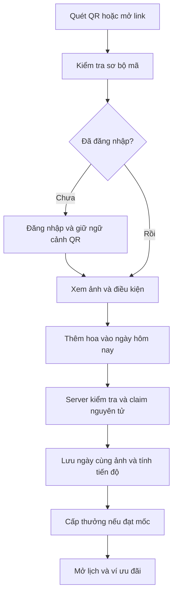
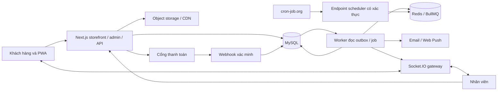

# Fleurious — Kế hoạch xây dựng website bán hoa

Ngày lập: 14/11/2026. Phạm vi: storefront, dashboard, hội viên, giữ chuỗi bằng QR, realtime và PWA. Đây là tài liệu kế hoạch và đặc tả đề xuất; chưa phải website đã triển khai.

**Cập nhật triển khai 14/11/2026:** Chủ dự án đã yêu cầu triển khai, chốt thanh toán **SePay** và giờ hiển thị **Hà Nội · UTC+7**, dùng IANA `Asia/Ho_Chi_Minh`. Các so sánh nhà cung cấp khác bên dưới được giữ làm tư liệu nghiên cứu; implementation chọn SePay chuyển khoản QR + webhook. Trạng thái thực thi, cách chạy, cấu hình bên ngoài và phần còn lại nằm trong [README](../README.md).

## 1. Kết luận định hướng

Xây dựng cửa hàng theo hướng **mobile-first, ảnh hoa làm trọng tâm, mua hàng ít bước**, với bảng màu Cellar Burgundy `#6e1423` và nền kem `#f4eade`. Liquid Glass xuất hiện ở các nút và lớp điều khiển nổi; phần nội dung duy trì độ tương phản và sự tối giản.

Dashboard tổ chức quanh hoạt động thực tế của cửa hàng hoa: nhận đơn → chuẩn bị → giao đúng giờ; có ba cách nhìn cùng dữ liệu là bảng, Kanban và lịch. Hội viên và chuỗi dùng chung hệ thống cấp ưu đãi để tránh giảm giá chồng chéo, nhưng có sổ ghi nhận riêng để đối soát.

Kiến trúc đề xuất: Next.js + TypeScript + MySQL, ứng dụng theo module, thêm tiến trình WebSocket và worker. Không cần chia nhiều microservice ở giai đoạn đầu.

### 1.1. Đã xác nhận với chủ dự án

- Hội viên có tối đa **N đơn được hưởng giá/ưu đãi hội viên mỗi tháng**.
- Hết N lượt, khách **vẫn đặt đơn với giá thường**, không bị khóa mua hàng.
- N và quyền lợi phải cấu hình được trong admin; profile cho biết hạng, số lượt và quyền lợi còn lại.
- QR từ một đơn có thể được người khác quét và đăng nhập để kích hoạt ngày giữ chuỗi; không buộc người quét là người mua.
- Chuỗi có hai loại mốc thưởng: ngày liên tiếp và số ngày hợp lệ trong tháng.

### 1.2. Giả định để lập kế hoạch, chưa phải quyết định kinh doanh cuối cùng

| Vấn đề | Đề xuất khởi điểm | Lý do / tác động |
|---|---|---|
| Thị trường, tiền tệ | Việt Nam, VND, một cửa hàng | Giữ phạm vi triển khai đầu tiên vừa phải |
| Múi giờ nghiệp vụ | `Asia/Ho_Chi_Minh` | Thống nhất quota, lịch giao, chuỗi |
| Đăng ký hội viên | Miễn phí; nâng ngay lên hạng Member sau xác minh tài khoản | Chưa có yêu cầu thu phí hội viên; không tự phát sinh subscription |
| Quota | Ví dụ 3 đơn/tháng, dùng chu kỳ tháng dương lịch | Giá trị demo, N thực tế do admin nhập |
| Phạm vi sản phẩm hội viên | Tất cả sản phẩm đang bán; ngoại lệ phải công bố | Giữ đúng ý “đơn bất kỳ”, tránh điều kiện ẩn |
| QR | Sinh ngay khi tạo đơn; thời điểm được claim có quy tắc riêng | Phân biệt tạo đơn với đơn hợp lệ để cấp thưởng |
| QR có thể claim | Trả trước: đã trả tiền và cửa hàng xác nhận; COD: đã giao | Đề xuất chống đơn ảo, cần chủ shop chốt trước phát triển |
| Sức chứa QR | Mặc định một người nhận thành công cho mỗi đơn | Ai có QR cũng có thể là người nhận; không đồng nghĩa số người nhận vô hạn |
| Hạn QR | Ví dụ 72 giờ từ lúc được phép claim | Đủ thời gian tặng hoa; hạn này cần thử nghiệm |
| Đếm ngày | Tối đa một ngày hợp lệ/tài khoản/ngày | Nhiều QR cùng ngày không tạo nhiều ngày |
| Cộng dồn ưu đãi | Mặc định một ưu đãi tiền hàng/đơn; phí giao và quà có luật riêng | Bảo vệ biên lợi nhuận và giải thích giá dễ hơn |

Nếu muốn QR kích hoạt ngay cả khi đơn mới tạo/chưa thanh toán, admin có chế độ `order_created`. Khi đó ngày được ghi **tạm**, phần thưởng có giá trị tiền chỉ khả dụng sau khi đơn đạt điều kiện hợp lệ. Đây là lựa chọn khác với mặc định khuyến nghị ở trên, phải được ghi rõ trong điều lệ và giao diện.

## 2. Nghiên cứu và lựa chọn

### 2.1. Liquid Glass và ngôn ngữ thiết kế 2025–2026

Apple giới thiệu Liquid Glass trong năm 2025 và hướng dẫn dùng vật liệu này có chọn lọc ở điều khiển, điều hướng; hiệu ứng cần thích nghi với nhu cầu giảm chuyển động và tăng khả năng đọc. Website sẽ lấy cảm hứng từ nguyên tắc đó, triển khai bằng CSS; không coi hiệu ứng CSS là bản sao đầy đủ của vật liệu native. Nguồn: [Apple — Materials](https://developer.apple.com/design/human-interface-guidelines/materials), [Adopting Liquid Glass](https://developer.apple.com/documentation/technologyoverviews/adopting-liquid-glass).

Áp dụng cho Fleurious:

- Nút chính có nền burgundy đủ đậm, chữ kem, viền sáng và phản xạ nhẹ để vừa có cảm giác kính vừa đọc rõ.
- Nút phụ dùng nền kem bán trong suốt, blur vừa phải, viền sáng; không để chữ mảnh trực tiếp trên ảnh hoa nhiều chi tiết.
- Bottom navigation và thanh mua hàng nổi có lớp kính riêng, khoảng đệm safe-area.
- Dùng `backdrop-filter` như tăng cường; có nền đặc khi không hỗ trợ hoặc khi người dùng bật chế độ giảm hiệu ứng trong website.
- Kiểm tra `prefers-reduced-motion`, chế độ tương phản và forced-colors; không giả định web nhận được mọi setting native của iOS.
- Tránh blur toàn màn hình, khúc xạ SVG/WebGL trên mọi nút hoặc hiệu ứng chạy liên tục gây nóng máy.

Định hướng “hiện đại 2025–2026” ở đây là lựa chọn thiết kế từ brief: ảnh lớn, bố cục biên tập, điều hướng vùng ngón tay cái, chuyển động ngắn, giao diện ít chữ. Không có một chuẩn duy nhất bắt buộc website phải đi theo tất cả xu hướng.

### 2.2. Masonry: dùng cho khám phá, kiểm soát thứ tự

MDN hiện đánh dấu CSS grid lanes/masonry là công nghệ thử nghiệm và chưa có khả năng tương thích rộng. Vì vậy không đặt toàn bộ catalogue lên CSS masonry native. Nguồn: [MDN — Grid lanes](https://developer.mozilla.org/en-US/docs/Web/CSS/Guides/Grid_layout/Grid_lanes).

- Trang chủ, bộ sưu tập và khám phá: masonry hai cột trên mobile, 3–4 cột trên desktop; tỷ lệ ảnh có giới hạn.
- Khi cần so sánh sản phẩm/giá: có nút chuyển sang lưới đồng đều; chế độ sắp xếp giá ưu tiên thứ tự đọc rõ ràng.
- Prototype bằng CSS Grid với các nhịp card cao/thấp đã định trước, DOM đi theo hàng; không dùng `dense` để đảo thứ tự hiển thị. Nếu cần masonry xếp sát thực sự, chỉ chọn adapter sau kiểm thử keyboard, screen reader và SSR.
- Không dùng CSS columns như giải pháp mặc định cho danh sách cần thứ tự trái → phải; thứ tự đọc dọc cột dễ khác kỳ vọng của khách.
- Ảnh có `width/height`, placeholder và tỷ lệ đã biết để không nhảy layout; card giữ giá và hành động nhìn được ở mọi chiều cao.
- Có phân trang tải thêm, URL thể hiện bộ lọc; quay lại giữ vị trí cuộn. Không chỉ có infinite scroll làm khách không tìm được footer.
- Bộ lọc trên mobile dùng bottom sheet, chip điều kiện đang chọn và tổng số kết quả. Nghiên cứu Baymard ủng hộ việc làm rõ bộ lọc đang áp dụng trên màn hình nhỏ: [Ecommerce filter UI](https://baymard.com/blog/ecommerce-filter-ui).

### 2.3. Chuyển động

Chọn CSS transition cho tương tác đơn giản và **Motion for React** cho sheet, chuyển trạng thái và bố cục. Motion có layout animation và cơ chế tôn trọng Reduced Motion. Nguồn: [Layout animations](https://motion.dev/docs/react-layout-animations), [MotionConfig](https://motion.dev/docs/react-motion-config).

| Tương tác | Đề xuất | Mục đích |
|---|---|---|
| Nhấn nút | Scale nhẹ 0.98, 120–160 ms | Phản hồi thao tác |
| Sheet / modal | Opacity + translate ngắn, 200–280 ms | Hiểu quan hệ giữa màn hình và lớp nổi |
| Thêm giỏ | Badge đổi trạng thái, 160–220 ms | Biết đã thêm thành công |
| Chuyển ảnh sản phẩm | Crossfade 180–250 ms | Xem hoa liên tục |
| Kích hoạt ngày | Ảnh hiện + ngọn lửa nhấn nhẹ, một lần | Ghi nhận thành công |
| Đạt mốc | Thông báo + hiệu ứng ngắn, một lần | Nhìn thấy phần thưởng |
| Kanban | Dịch chuyển card ngắn, có rollback khi lỗi | Hiểu trạng thái đã đổi |

Không chặn checkout để chờ animation. Không dùng parallax mạnh, cursor tùy biến hoặc hiệu ứng hover làm hành động chỉ dùng được bằng chuột. Khi giảm chuyển động, giữ thông báo thành công bằng chữ/icon và thay chuyển động lớn bằng opacity. Mọi thời lượng là thông số thiết kế đề xuất, sẽ hiệu chỉnh trên thiết bị thật.

### 2.4. Hội viên: tham khảo ngành hoa

Bloom & Wild có quyền lợi như ưu đãi riêng, quà sinh nhật, tiếp cận đợt bán sớm; UrbanStems minh họa cách gói hoa định kỳ kết hợp giao miễn phí, bình hoa và quản lý lịch giao. Đây là nguồn ý tưởng, không sao chép mức giá hoặc điều khoản của họ. Nguồn: [Bloom & Wild Rewards VIP](https://www.bloomandwild.com/join-rewards-vip), [UrbanStems subscriptions](https://help.urbanstems.com/en-US/how-do-subscriptions-work-1959122).

Đề xuất ưu đãi phù hợp cửa hàng:

- N đơn được áp dụng giá hội viên hoặc giảm phần trăm có trần.
- Thiệp thiết kế hoặc nâng cấp giấy gói trong một số lượt.
- Hỗ trợ phí giao trong khu vực, có trần tiền và số lượt.
- Quà hoặc voucher tháng sinh nhật, một lần/năm; đổi ngày sinh không làm phát sinh thêm quà.
- Xem trước bộ sưu tập giới hạn, đặt trước cho các dịp cao điểm.
- Nhắc lịch ngày kỷ niệm theo lựa chọn của khách; không tự gửi thông báo ngoài sự đồng ý.
- Chăm sóc hoa sau mua và gợi ý chọn hoa theo ngân sách.
- Giai đoạn sau: điểm thưởng, giới thiệu bạn bè sau đơn hoàn tất, workshop hoặc gói hoa định kỳ.

Ưu tiên quyền lợi có chi phí biên thấp như thiệp, giấy gói, truy cập sớm. Không mặc định miễn phí giao toàn quốc hoặc giảm giá không giới hạn.

### 2.5. Giữ chuỗi: phần nào học từ Locket

Tài liệu chính thức của Locket xác nhận Memories Calendar và cơ chế khôi phục chuỗi cho Locket Gold trong một ngày sau khi mất, bằng ảnh từ camera roll. Nguồn này không phải tài liệu đầy đủ về toàn bộ thuật toán chuỗi của Locket. Nguồn: [Locket — Restore a streak](https://help.locket.com/en/articles/14189020-how-do-i-restore-my-locket-streak).

Fleurious lấy cảm hứng ở lịch ảnh, tín hiệu ngọn lửa và cảm giác lưu kỷ niệm. **Quy tắc quét QR, một ngày hợp lệ, mốc thưởng và chống gian lận bên dưới là thiết kế riêng cho cửa hàng**, không gán chúng cho Locket.

Đặc biệt: không nên yêu cầu mua hoa mỗi ngày để chuỗi trở thành động lực chính. Giữ QR chia sẻ cho người nhận, tập trung mốc tích lũy tháng; chuỗi liên tiếp là thử thách phụ. Sau khi có dữ liệu thực tế mới cân nhắc một chương trình chăm hoa/check-in ảnh riêng, không trộn với QR mua hàng nếu chưa có luật mới.

## 3. Design system xuyên suốt

### 3.1. Token nền tảng

| Thành phần | Định hướng |
|---|---|
| Màu thương hiệu | Burgundy `#6e1423` |
| Nền chính | Cream `#f4eade` |
| Nền card | Trắng ấm, có nền đặc cho dữ liệu quan trọng |
| Chữ | Màu đậm; màu phụ phải được đo tương phản trên nền thật |
| Màu trạng thái | Success, warning, error bổ sung; luôn có nhãn/icon |
| Chữ tiêu đề | Serif có hỗ trợ tiếng Việt; thử Lora hoặc tương đương |
| Chữ nội dung | Sans hỗ trợ tiếng Việt; thử Be Vietnam Pro hoặc tương đương |
| Khoảng cách | Hệ 4/8 px; mobile gutter 16–20 px |
| Bo góc | 12–20 px cho card, pill cho nút và chip |
| Vùng chạm | Mục tiêu tối thiểu 44×44 px |
| Icon | Một bộ SVG thống nhất; icon đơn độc có accessible name |
| Ảnh | Ánh sáng tự nhiên, nền tiết chế, màu hoa trung thực |

Logo, màu, type scale, trạng thái nút, input, chip, modal, toast, card và các trạng thái empty/loading/error phải được tài liệu hóa trước khi nhân rộng các trang.

Icon hoa, lịch, xe giao hàng, thiệp, quà, hội viên và ngọn lửa giúp quét thông tin nhanh. Với thao tác quan trọng, dùng icon đi cùng nhãn ngắn như “Ngày giao”, “Giữ chuỗi”, “Quyền lợi”; không bắt khách đoán nghĩa biểu tượng.

### 3.2. Các mẫu giao diện dùng chung

- Storefront: header gọn, tìm kiếm rõ, bottom nav 4 mục “Khám phá / Bộ sưu tập / Giữ chuỗi / Tài khoản”; giỏ nằm ở header và CTA ngữ cảnh để tránh nhồi 5–6 mục.
- Trang chi tiết: thanh giá + mua cố định ở đáy, chừa safe-area và không che nội dung cuối trang.
- Checkout: một luồng tập trung, hiển thị bước tiến trình, tạm ẩn bottom nav nếu gây xao nhãng.
- Admin desktop: sidebar + khu vực thao tác; mobile: drawer, các thao tác thường dùng đưa lên đầu.
- Có empty state có ích: chưa có hoa yêu thích, chưa có ngày chuỗi, hết lượt hội viên, QR đã dùng, lịch không có đơn.
- Tất cả thời hạn dùng ngày/giờ cụ thể: “Dùng trước 23:59, 30/11”, tránh chỉ ghi “sắp hết hạn”.

## 4. Client side: sitemap và phạm vi chức năng

| Trang / khu vực | Chức năng chính | Ghi chú mobile |
|---|---|---|
| Trang chủ `/` | Hero, giao trong khu vực, dịp tặng, sản phẩm nổi bật, hội viên, giữ chuỗi | Một CTA chính ở vùng đầu |
| Khám phá `/flowers` | Masonry/lưới, tìm kiếm, lọc giá, loại hoa, màu, dịp, sẵn giao | Filter sheet, chip xóa nhanh |
| Bộ sưu tập `/collections/[slug]` | Sinh nhật, kỷ niệm, khai trương, hoa theo mùa | Nội dung biên tập ngắn |
| Chi tiết `/flowers/[slug]` | Gallery, size, giá, tồn khả dụng, ngày/slot, thiệp, add-on, chăm hoa, đánh giá | CTA cố định, chọn biến thể rõ |
| Yêu thích | Lưu sản phẩm, thêm giỏ, đồng bộ tài khoản | Khách có thể lưu tạm trên máy |
| Giỏ `/cart` | Sửa số lượng, ghi chú, add-on, tóm tắt quyền lợi | Tính lại giá trên server |
| Checkout `/checkout` | Người đặt, người nhận, địa chỉ, ngày/giờ, thiệp, voucher, thanh toán | Hỗ trợ người mua khác người nhận |
| Thanh toán | COD theo vùng/điều kiện, một cổng online ở bản đầu | Phân biệt chờ tiền với thành công |
| Kết quả đặt hàng | Mã đơn, tóm tắt, trạng thái, QR giữ chuỗi và điều kiện dùng | Hai QR thanh toán/giữ chuỗi có nhãn khác nhau |
| Theo dõi đơn | Timeline, lịch giao, liên hệ hỗ trợ, thay đổi hợp lệ | Realtime khi mở trang |
| Auth | Đăng ký, đăng nhập, xác minh, quên mật khẩu | Quay lại đúng giỏ hoặc QR sau login |
| Profile `/account` | Thông tin, địa chỉ, đơn, hội viên, voucher, lịch ảnh, tùy chọn thông báo | Các card ngắn, ưu tiên tác vụ |
| Hội viên `/membership` | Giới thiệu gói/hạng, N lượt, quyền lợi, đăng ký, điều lệ | Nút đăng ký và lợi ích nổi bật |
| Giữ chuỗi `/streak` | Lịch ảnh, liên tiếp, tích lũy tháng, mốc thưởng, cách dùng QR | Xem chi tiết một ngày bằng sheet |
| Ví ưu đãi `/account/rewards` | Khả dụng, đã dùng, hết hạn, điều kiện, áp dụng vào giỏ | Không bắt khách ghi nhớ mã |
| QR `/q/[token]` | Kiểm tra, đăng nhập, claim, phản hồi lỗi rõ | Có link mở thay vì bắt camera trong web |
| Nội dung | Giới thiệu, chăm hoa, FAQ, giao hàng, đổi trả, chính sách | Nội dung do CMS quản lý |
| Liên hệ | Form, thông tin cửa hàng, liên kết kênh hỗ trợ | Không cần xây chat riêng ngay |

### 4.1. Nghiệp vụ đặc thù bán hoa

- Sản phẩm có size/biến thể, giá, SKU, ảnh và định mức nguyên liệu tùy mức quản lý kho.
- Ngày giao, khung giờ, thời gian chuẩn bị tối thiểu, cutoff đặt trong ngày, ngày nghỉ và sức chứa từng slot.
- Phí giao theo khu vực/quy tắc; kiểm tra khả năng giao trước khi nhận thanh toán.
- Hoa theo mùa: ghi rõ khả năng thay hoa, cho khách chọn “liên hệ trước khi thay” hoặc mức thay tương đương đã đồng ý.
- Tách người mua/người nhận, thiệp riêng tư, tùy chọn không lộ giá khi gửi quà.
- Thêm bình, chocolate, thiệp hoặc giấy gói dưới dạng order item/add-on có giá và tồn riêng.
- Có luồng đề nghị đổi hoa/đổi giờ, ghi lại khách đồng ý; không tự thay nội dung đã thanh toán.
- Cửa hàng có thể đính kèm ảnh bó hoa hoàn thiện để duyệt hoặc làm bằng chứng giao hàng theo chính sách lưu giữ.
- MVP quản lý số lượng khả dụng theo sản phẩm/biến thể và slot; BOM theo cành hoa, hao hụt và lô nhập là giai đoạn mở rộng.

### 4.2. Luồng mua hàng

Khám phá → chọn hoa/size → kiểm tra ngày giao → thêm giỏ → thông tin người nhận → chọn ưu đãi → thanh toán → xác nhận → theo dõi.

Cho phép guest checkout; hội viên và nhận chuỗi cần tài khoản. Nếu khách đăng nhập ở checkout, hợp nhất giỏ, tính lại giá và hiển thị thay đổi trước khi trả tiền. Đơn khách vãng lai chỉ gắn vào tài khoản sau bước xác minh phù hợp, không chỉ dựa vào email người dùng nhập.

## 5. Admin side: quản lý đầy đủ

| Module | Chức năng |
|---|---|
| Tổng quan | Đơn hôm nay, lịch giao, việc trễ, doanh số theo định nghĩa rõ, cảnh báo tồn và thanh toán |
| Đơn hàng | Danh sách, tìm/lọc, chi tiết, tạo đơn thủ công, chuyển trạng thái hợp lệ, ghi chú, phân công, in phiếu |
| Kanban | Cột tiến trình, kéo thả có điều kiện, người phụ trách, deadline, cảnh báo trễ |
| Lịch giao | Ngày/tuần/tháng, agenda, lọc vùng/nhân viên/trạng thái, sức chứa từng slot |
| Sản phẩm | CRUD, biến thể, ảnh, SKU, giá thường/hội viên, trạng thái, sản phẩm liên quan, SEO |
| Phân loại | Danh mục, bộ sưu tập, màu, dịp, tag, thứ tự hiển thị |
| Kho | Tồn, giữ chỗ, điều chỉnh, lịch sử nhập/xuất; sau đó nguyên liệu/lô/hao hụt |
| Khách hàng | Hồ sơ, lịch sử đơn, địa chỉ, ghi chú được phân quyền, trạng thái xác minh |
| Hội viên | Gói/quyền lợi, hạng, điều kiện lên hạng, N, lịch sử quota, điều chỉnh có lý do |
| Giữ chuỗi | Chiến dịch, luật ngày, QR, lượt claim, lịch người dùng, mốc thưởng, ngân sách |
| Ưu đãi | Voucher, điều kiện, mức giảm, cap, quota, thời hạn, chống cộng dồn, lịch sử dùng |
| Thanh toán | Giao dịch, đối soát, trả tiền thừa/thiếu, webhook lỗi, hoàn tiền và phê duyệt |
| Giao hàng | Khu vực, phí, slot, cutoff, ngày nghỉ, phân công, giao thất bại |
| Nội dung | Banner, block trang chủ, bài viết, FAQ, chính sách, footer |
| Đánh giá | Duyệt, báo cáo, liên kết đơn đã mua, phản hồi |
| Thông báo | Mẫu email/push, phân loại giao dịch/marketing, lịch gửi, opt-in |
| Báo cáo | Bán hàng, sản phẩm, giao đúng giờ, khách quay lại, chi phí hội viên/chuỗi |
| Nhân sự và quyền | Vai trò, quyền theo hành động, khóa phiên, 2FA cho tài khoản quản trị |
| Cài đặt | Thương hiệu, cửa hàng, múi giờ, thanh toán, PWA, analytics, cấu hình hội viên/chuỗi |
| Nhật ký | Audit thay đổi giá/luật/quota/trạng thái, lỗi jobs, xuất dữ liệu, kiểm tra hoạt động |

“CRUD đầy đủ” không có nghĩa cho xóa vĩnh viễn mọi dữ liệu: sản phẩm có đơn được archive; đơn, giao dịch và ledger ưu đãi dùng hủy/đảo trạng thái và lưu vết.

Vai trò khởi điểm: Owner; quản lý cửa hàng; xử lý đơn/CSKH; florist; giao hàng; kế toán; marketing. Owner có toàn quyền, florist chỉ xem thông tin cần chuẩn bị, giao hàng chỉ xem thông tin cần giao, marketing không xem dữ liệu thiệp riêng tư hoặc bí mật thanh toán.

### 5.1. State machine đơn hàng

Tách ba trục, tránh tạo một trạng thái khổng lồ bao gồm cả tiền và sản xuất:

| Trục | Trạng thái đề xuất |
|---|---|
| Đơn hàng | pending_confirmation → confirmed → completed; nhánh cancelled |
| Thanh toán | unpaid → pending → paid; nhánh failed/expired; paid → partially_refunded/refunded |
| Fulfillment | unassigned → preparing → ready → out_for_delivery → delivered; nhánh delivery_failed/returned |

Kanban thể hiện fulfillment, có vùng chờ xác nhận và badge thanh toán. Kéo card không tự biến đơn thành đã trả tiền. Chỉ chuyển khi đủ điều kiện: có người chuẩn bị, đã xác nhận, đáp ứng chính sách COD, có slot; thao tác ngoại lệ yêu cầu quyền và lý do.

Mỗi cập nhật gửi `expectedVersion`; nếu hai nhân viên sửa cùng lúc, server từ chối bản cũ, trả trạng thái mới để UI tải lại. Không cho kéo lùi từ đã giao sang đang chuẩn bị như một chỉnh sửa thông thường.

### 5.2. Kanban và lịch trên mobile

- Desktop: Kanban nhiều cột; mobile: một cột tại một thời điểm hoặc danh sách theo trạng thái, có nút “Chuyển trạng thái”.
- Kéo thả là thao tác bổ sung; mọi hành động đều dùng được bằng nút và bàn phím.
- Card đơn: mã, ảnh nhỏ, giờ hẹn, khu vực, giá trị, trạng thái tiền, phụ trách; ẩn bớt dữ liệu cá nhân ở màn tổng quan.
- Lịch mặc định theo **ngày giao**, không theo ngày tạo đơn. Có bộ chọn chuyển góc nhìn nếu cần phân tích ngày nhận đơn.
- Mobile dùng agenda theo giờ; desktop có tháng/tuần/ngày. Chọn một ngày mở danh sách và tổng lượng cần chuẩn bị.
- Kéo đổi lịch phải kiểm tra cutoff, công suất, phí; nếu cần khách đồng ý thì tạo yêu cầu thay đổi thay vì đổi âm thầm.
- Chọn FullCalendar cho lịch chuẩn; resource timeline/scheduler thuộc nhóm Premium, cần xem license trước khi mua. Nguồn: [FullCalendar Premium](https://fullcalendar.io/docs/premium).

## 6. Hội viên: đặc tả nghiệp vụ

### 6.1. Hạng và quyền lợi là hai khái niệm tách biệt

- **Tư cách hội viên**: enrolled/active/suspended/expired; xác định có tham gia chương trình không.
- **Hạng**: Member → Bloom → Burgundy là ví dụ tên; admin thay tên và ngưỡng.
- **Gói quyền lợi**: N đơn ưu đãi/tháng, giảm giá, quà, giao hàng; là rule có phiên bản.
- Đăng ký thành công nâng từ khách thường lên Member. Hạng cao hơn có thể dựa trên số đơn đã giao hoặc chi tiêu ròng sau hoàn tiền trong một khoảng thời gian.
- Ngưỡng lên hạng, kỳ xét hạng và giữ hạng phải hiển thị; không hạ hạng bất ngờ khi admin sửa cấu hình.
- Nếu sau này có membership trả phí, thêm checkout/gia hạn/hủy riêng; không thu tiền tự động chỉ vì đã đăng ký miễn phí.

### 6.2. Luồng người dùng

1. Xem trang hội viên và bản tóm tắt lợi ích/điều kiện.
2. Đăng nhập hoặc tạo tài khoản, xác minh kênh liên hệ.
3. Chọn tham gia, lưu đồng ý điều lệ và phiên bản.
4. Server tạo enrollment và kỳ quyền lợi, nâng hạng Member, gửi thông báo thành công.
5. Profile hiển thị “Còn 2/3 đơn ưu đãi trong tháng 11. Làm mới vào 01/12”.
6. Trang sản phẩm hiển thị giá thường và giá hội viên kèm điều kiện; checkout xác nhận có dùng lượt hay không.
7. Khi hết lượt: “Bạn đã dùng hết 3 lượt tháng này. Vẫn có thể mua theo giá thường”. Không chặn checkout.

Khách được chọn giữ lượt cho đơn khác; không ép tự dùng lượt hội viên nếu voucher khác tốt hơn. Nếu ưu đãi hội viên chỉ áp dụng trên một phần giỏ, tóm tắt phải chỉ rõ phần đủ điều kiện.

### 6.3. Quota và vòng đời một lượt

Mỗi kỳ có `limit`, `reserved`, `consumed`, `released`, `adjustments`; số còn lại tính từ ledger hợp lệ, không lấy bộ đếm ở trình duyệt làm căn cứ.

- Chu kỳ là `[00:00 ngày 1, 00:00 ngày 1 tháng kế tiếp)` theo giờ Việt Nam; lưu timestamp UTC cùng khóa kỳ nghiệp vụ.
- Một **đơn dùng quyền lợi** tốn một lượt dù có nhiều sản phẩm. Thêm sản phẩm vào cùng đơn không tạo thêm lượt; quy tắc sửa đơn phải tính lại giá.
- Bắt đầu checkout có báo giá; chỉ giữ lượt khi tạo đơn/thanh toán để tránh mở giỏ cũng chiếm quota.
- Ví dụ giữ lượt 15 phút với thanh toán online. TTL này đồng bộ với hạn payment request.
- Thanh toán hợp lệ: chuyển reserved → consumed trong transaction. COD: consumed khi cửa hàng chấp nhận đơn; có thể hoàn lượt nếu hủy hợp lệ.
- Hết hạn/thất bại/hủy trước xử lý: release đúng kỳ đã giữ; có cơ chế đối soát nếu job chậm.
- Hết N lượt: checkout tính lại giá thường hoặc chọn voucher khác trước khi khách xác nhận trả tiền; không âm thầm thu thêm khi đã thanh toán.
- Giữ lượt lúc 23:59 và trả tiền 00:03: dùng kỳ đã giữ nếu reservation còn hạn; không chiếm cả hai kỳ.
- Không cần job reset toàn bộ user vào nửa đêm. Kỳ mới được mở theo thời gian server; cron dùng để nhắc, tổng hợp và đối soát.
- Chống nhiều tab cùng dùng lượt cuối bằng khóa hàng/atomic update và unique constraint, có retry khi deadlock.

MySQL có locking read `FOR UPDATE` phù hợp kiểm soát cập nhật đồng thời. Nguồn: [MySQL — Locking reads](https://dev.mysql.com/doc/refman/8.4/en/innodb-locking-reads.html).

### 6.4. Hủy và hoàn tiền

| Tình huống | Xử lý đề xuất |
|---|---|
| Đơn chưa được xác nhận, thanh toán lỗi | Trả reservation |
| Hủy trước chuẩn bị, hoàn toàn bộ | Trả lượt vào kỳ gốc nếu kỳ còn mở |
| Hủy sau khi kỳ đã đóng | Không cộng sang kỳ mới tự động; shop có thể cấp bù riêng có audit |
| Hoàn một phần | Giữ lượt; hoàn theo số tiền thực trả đã phân bổ giảm giá |
| Đơn đã giao, hoàn vì chất lượng | Theo chính sách công bố; admin có thể cấp bù, không tùy tiện sửa ledger |
| Webhook/giao dịch lặp | Không consume hoặc hoàn lượt thêm lần nữa |
| Admin đổi N giữa tháng | Mặc định áp dụng kỳ sau; thay ngay cần preview tác động, không làm mất lượt đã dùng |
| Lên hạng giữa tháng | Có thể cộng phần chênh quota đã công bố; không reset số lượt đã dùng |

### 6.5. Cấu hình admin

`enabled`, tên chương trình, điều kiện đăng ký, tier, ngưỡng thăng hạng, N theo hạng, tháng áp dụng, phương thức ưu đãi, SKU/category ngoại lệ, trần giảm, quyền lợi giao hàng/quà, cộng dồn, reservation TTL, điều kiện hoàn lượt, ngày có hiệu lực, phiên bản điều lệ.

Mỗi lần publish cần xem trước bằng một giỏ hàng mẫu, thống kê số hội viên ảnh hưởng và lịch sử người sửa. Tạm dừng nhận hội viên mới không tự tước quyền lợi đã cam kết của người đang active.

## 7. Giữ chuỗi bằng QR: đặc tả trọng tâm

### 7.1. Từ ngữ hiển thị

| Tên | Ý nghĩa với khách | Cách tính |
|---|---|---|
| Ngày có hoa | Một ngày đã kích hoạt QR hợp lệ | Một ngày/tài khoản theo giờ Việt Nam |
| Chuỗi liên tiếp | Có ngày hợp lệ không bị đứt quãng | Các ngày lịch liền nhau |
| Ngày tích lũy trong tháng | Tổng ngày hợp lệ trong tháng | Ngày không cần liền nhau |
| Kỷ lục | Chuỗi liên tiếp dài nhất | Tính từ lịch sử hợp lệ |
| Phần thưởng | Quyền lợi đã được cấp từ một mốc | Có thời hạn và điều kiện riêng |

Không gọi “5 ngày trong tháng” là “chuỗi 5 ngày liên tiếp”. Trên mobile dùng hai card hoặc tab, mỗi card chỉ trả lời một mục tiêu.

### 7.2. QR sinh ra như thế nào

1. Tạo đơn thành công trong MySQL, đồng thời tạo `qr_grant` và outbox event trong cùng transaction.
2. QR chứa link HTTPS với token ngẫu nhiên đủ mạnh, không chứa địa chỉ, số điện thoại, ID tăng dần hoặc dữ liệu thanh toán.
3. Trạng thái ban đầu: pending eligibility hoặc active, theo trigger đã chọn.
4. Hiển thị QR trên trang đơn và bản in/thiệp. Gắn nhãn rõ **“Quét để thêm ngày có hoa”**; không nhầm với QR trả tiền.
5. Khi đạt trigger, server xác định `eligible_at`, `expires_at`, ảnh đại diện và giới hạn claim.
6. QR có thể tải/in qua endpoint được cấp quyền; nếu mất/thu hồi, rotate token làm mã cũ hết hiệu lực.

Đơn có nhiều sản phẩm: mặc định dùng ảnh item chính theo quy tắc ổn định (item hoa đầu tiên), cho chọn ảnh đại diện trước lần claim đầu tiên. Lịch lưu snapshot ảnh/sản phẩm để việc sửa hoặc archive sản phẩm không xóa kỷ niệm cũ.

### 7.3. Luồng quét và nhận ngày

- GET/preview không tiêu thụ QR; bot xem link hoặc prefetch không được làm mất lượt.
- Khách không cần là người mua, không cần có hội viên để nhận chuỗi, trừ chiến dịch có điều kiện riêng được công bố.
- Sau đăng nhập, một nút xác nhận ngắn giúp người dùng biết mình đang nhận ngày vào tài khoản nào.
- Server kiểm tra phiên, tính hợp lệ của đơn, hạn QR, số người nhận, đã claim đơn này chưa, ngày hôm nay đã có chưa, hạn mức chiến dịch.
- Nếu hôm nay đã có ngày hợp lệ, không tiêu tốn QR mới. Cho khách biết có thể dùng trước thời hạn vào ngày khác nếu mã vẫn còn hiệu lực; không hứa tự giữ mã nếu người khác có thể claim trước.
- Quét lại cùng mã sau khi đã claim không được tạo ngày mới vào ngày mai. Unique `(user_id, qr_grant_id)` ngăn tái sử dụng qua ngày.
- Khi thành công: “Đã thêm hoa vào 14/11. Bạn có 4 ngày liên tiếp; thêm 1 ngày để nhận giảm 5%”.
- Thời điểm ngày hợp lệ lấy từ server khi giao dịch claim được chấp nhận; không lấy đồng hồ điện thoại hoặc ngày giao đơn.

### 7.4. Quy tắc mặc định đề xuất

| Quy tắc | Giá trị đề xuất |
|---|---|
| Một ngày hợp lệ | Một claim thành công trong ngày địa phương |
| Một QR | Một người nhận toàn hệ thống; admin có thể tăng cho chiến dịch nhóm |
| Mỗi user/mỗi QR | Một lần duy nhất, kể cả khác ngày |
| Nhiều đơn cùng ngày | Chỉ tạo một ngày thưởng; không tiêu thụ QR thừa |
| Liên tiếp | Chênh lệch ngày lịch đúng 1; không dùng “trong vòng 24 giờ” |
| Qua tháng | Chuỗi liên tiếp tiếp tục; bộ đếm tích lũy tháng bắt đầu kỳ mới |
| Không quét hôm nay | Nếu ngày cuối là hôm qua, vẫn hiển thị chuỗi đang chờ tiếp nối hôm nay |
| Mất chuỗi | Khi đã bỏ trọn một ngày, current streak về 0; giữ kỷ lục và tích lũy tháng |
| Khôi phục | MVP tắt; có thể bổ sung vé bảo vệ không mặc định tạo quyền nhận thưởng tiền |
| Offline | Chỉ claim khi kết nối server; không tự backdate sau khi online |
| Ảnh lịch | Riêng tư theo tài khoản; không hiển thị người mua/người nhận khác |

Ví dụ ngày 1, 2, 3, 7, 9 đều có QR hợp lệ: tích lũy tháng là 5; chuỗi hiện tại ở ngày 9 là 1, chuỗi dài nhất là 3. Nếu ngày 10 và 11 cũng có thì chuỗi hiện tại là 3, tích lũy tháng là 7.

**Hệ quả cần chủ shop hiểu:** QR dùng một lần và chỉ có từ đơn hàng thì việc giữ 30 ngày liên tiếp đòi hỏi lượng đơn/QR rất lớn. Không nên đặt thưởng chính ở mốc này trước khi xác nhận tần suất mua, tặng và chia sẻ thực tế.

### 7.5. Lịch ảnh dễ hiểu trên mobile

Thứ tự nội dung:

1. Tóm tắt “Hôm nay chưa có hoa” hoặc “Đã thêm hoa hôm nay”.
2. Card “Liên tiếp 4 ngày 🔥 — Còn 1 ngày để nhận giảm 5%”.
3. Card “Tháng này 7 ngày có hoa — Đã nhận mốc 5, còn 3 để tới mốc 10”.
4. Lịch tháng 7 cột; mỗi ô có ngày, thumbnail nếu active, ngọn lửa ở góc phải ảnh.
5. Chọn một ngày mở sheet ảnh lớn, sản phẩm, thời gian kích hoạt, phần thưởng liên quan; không lộ chi tiết đơn của người khác.
6. Danh sách mốc kế tiếp và mục “Ưu đãi đã nhận”.

Ô hôm nay có đường viền; ngày active có ảnh; ngày chưa active dùng nền trung tính; mốc có icon quà. Lửa chỉ dấu hiệu đã active, không dùng làm thông tin duy nhất. Screen reader đọc được “14 tháng 11, đã có hoa”. Không để icon che ngày hoặc chủ thể hoa.

Không bắt nhét nhiều chữ vào ô lịch. Progress bar, label và giải thích mốc nằm ngoài lịch. Có nút “Cách tính” mở ba ví dụ ngắn; ngày/giờ kết thúc luôn ghi theo giờ Việt Nam.

### 7.6. Mốc thưởng và luật cấp

Các con số dưới đây là **ví dụ để thiết kế**, chưa phải ngân sách đã duyệt:

| Mốc | Kiểu | Thưởng minh họa | Chống cấp lặp |
|---|---|---|---|
| 5 ngày có hoa/tháng | Tích lũy | Giảm 2%, tối đa 20.000đ, đơn từ 300.000đ | Một lần/tài khoản/tháng/mốc |
| 10 ngày có hoa/tháng | Tích lũy | Thiệp miễn phí hoặc nâng giấy gói | Một lần/tài khoản/tháng/mốc |
| 5 ngày liên tiếp | Liên tiếp | Giảm 5%, tối đa 50.000đ, đơn từ 400.000đ | Mặc định một lần/tài khoản/tháng/mốc |
| 7 ngày liên tiếp | Liên tiếp | Hỗ trợ phí giao tối đa 25.000đ | Mặc định một lần/tài khoản/tháng/mốc |

Thưởng liên tiếp có **kỳ cấp thưởng** độc lập với độ dài chuỗi. Mặc định chỉ cấp khi thực sự vượt mốc trong kỳ; bước sang tháng khi đang ở chuỗi 12 ngày không tự cấp lại mốc 5. Nếu muốn thưởng mỗi 5 ngày, phải chọn mode lặp và có giới hạn rõ, không suy diễn từ mốc một lần.

Khi một claim đạt cả mốc tháng và liên tiếp, có thể cấp hai voucher nếu chiến dịch cho phép; vẫn không mặc định được dùng cả hai trong một checkout. Wallet hiển thị riêng từng phần thưởng.

Cấu hình một rule:

- Tên, loại `consecutive_days` / `monthly_active_days`, threshold, ngày chạy chiến dịch, đối tượng.
- Kỳ cấp, số lần cấp tối đa, mode mốc một lần hoặc lặp rõ ràng, ngân sách toàn chiến dịch.
- Loại thưởng: phần trăm, tiền cố định, phí giao, quà, điểm.
- Phạm vi: item/SKU/category hoặc subtotal tiền hàng đủ điều kiện; không dùng nhãn mơ hồ “giảm trên tổng đơn”.
- Minimum spend, trần giảm, ngày hết hạn, ngoại lệ, cộng dồn, số lượt sử dụng.
- Điều kiện nguồn đơn, QR expiry, số người nhận, xử lý hoàn/hủy.
- Phiên bản, thời điểm có hiệu lực, người sửa và preview tác động.

### 7.7. Mô hình giảm giá thống nhất

Luồng tính giá: giá niêm yết/biến thể → giá chương trình hợp lệ → phân bổ ưu đãi tiền hàng → phí giao và hỗ trợ phí giao → khoản thu khác nếu có → tổng thanh toán.

Đối với giá hội viên riêng theo SKU, coi đó là một loại offer khi so sánh với voucher. Mặc định không áp thêm voucher phần trăm lên giá hội viên trừ khi admin bật luật cộng dồn cụ thể.

- Giảm theo item chỉ tác động dòng đủ điều kiện.
- Giảm trên subtotal tính trên tiền hàng đủ điều kiện, không tự tính trên phí giao.
- Phí giao dùng reward riêng; không tạo tổng tiền âm.
- Phân bổ giảm giá xuống từng order item để hoàn một phần chính xác.
- VND lưu số nguyên đồng và quy tắc làm tròn thống nhất; không dùng float cho tiền.
- Khách chọn ưu đãi; hệ thống có thể đề xuất phương án tiết kiệm nhất nhưng phải cho biết số lượt hội viên bị dùng.
- Ví dụ giỏ 600.000đ, giao 30.000đ: voucher 5% trên tiền hàng, cap 50.000đ, giảm 30.000đ → trả 600.000đ. Nếu có thêm quyền lợi giao hàng được phép cộng dồn, tính tiếp ở dòng phí giao.

### 7.8. Cấp thưởng đúng một lần và xử lý sự cố

Trong transaction claim: khóa grant/counter liên quan → kiểm tra quota → ghi claim → ghi ngày duy nhất → tính mốc → ghi reward entitlement có unique key → ghi outbox → commit. Worker chỉ gửi thông báo hoặc đồng bộ, không phải nguồn quyết định ngày đã hợp lệ.

Unique key cấp thưởng: `(user_id, campaign_id, rule_version_id, reward_period_key, milestone_occurrence)`. Khi thay phiên bản rule, cần bảng ánh xạ quyền lợi kế thừa để không dùng version mới cấp lại mốc cũ ngoài ý muốn.

| Tình huống | Kết quả |
|---|---|
| Hai người tranh QR cuối cùng | Chỉ một transaction thành công; người còn lại thấy “QR đã được nhận” |
| Người dùng bấm hai lần/retry sau timeout | Trả kết quả claim cũ bằng idempotency key; không thêm ngày/thưởng |
| Worker lỗi sau commit | Ngày/thưởng đã ghi vẫn đúng; outbox retry thông báo |
| Đơn hủy trước đủ điều kiện | QR mất hiệu lực; không tạo thưởng khả dụng |
| Nguồn đơn gian lận/claim sai | Vô hiệu claim bằng bản ghi đảo, tính lại chuỗi; thu hồi reward chưa dùng |
| Hoàn vì chất lượng sau giao thực tế | Đề xuất giữ kỷ niệm/ngày hợp lệ; tài chính xử lý theo chính sách công bố |
| Voucher đã dùng trước khi phát hiện gian lận | Không tự sửa hóa đơn đã chốt; gắn cờ để xử lý, giới hạn tài khoản khi có bằng chứng |
| Đã đạt mốc nhưng hết ngân sách | Áp rule công bố; giữ quyền đã cam kết hoặc báo hết trước khi tham gia, không âm thầm bỏ thưởng |
| Admin tắt chương trình | Dừng claim mới theo lịch công bố; lịch cũ và voucher đã cấp xử lý theo điều lệ |

Để tránh nhận QR trộm: không đăng QR thực trên ảnh sản phẩm/mạng xã hội, không ghi token vào analytics hoặc log; dùng `Referrer-Policy`, trang QR không tải script bên thứ ba không cần thiết. Có rate limit theo tài khoản/IP; IP chung không đủ làm bằng chứng khóa người dùng. Nếu claim mở cho nhiều người, bắt buộc có cap và ngân sách để một ảnh QR chia sẻ không phát thưởng vô hạn.

## 8. Analytics và báo cáo admin

### 8.1. Công cụ nên tích hợp

| Công cụ | Vai trò | Lựa chọn |
|---|---|---|
| Báo cáo nội bộ MySQL | Đơn thực, thanh toán, hoàn, quota, reward và chi phí | Bắt buộc; nguồn nghiệp vụ |
| GA4 | Kênh truy cập, campaign, funnel ecommerce, hiệu quả marketing | Tích hợp khi mở bán/marketing |
| PostHog | Funnel đăng ký hội viên, QR → login → claim, retention/cohort, trải nghiệm sản phẩm | Ưu tiên cho hai tính năng khác biệt |
| Microsoft Clarity | Heatmap/session recording để tìm khó khăn mobile | Tùy chọn nếu chưa dùng replay khác; không bật trùng mặc định |
| Metabase | Phân tích SQL và dashboard nội bộ sâu hơn trên MySQL | Sau MVP khi có nhu cầu BI |

GA4 có bộ ecommerce event cho xem hàng, giỏ, checkout, mua và hoàn; PostHog hỗ trợ funnels/retention; Metabase kết nối MySQL; Clarity hỗ trợ masking. Nguồn: [GA4 ecommerce](https://developers.google.com/analytics/devguides/collection/ga4/ecommerce), [PostHog funnels](https://posthog.com/docs/product-analytics/funnels), [PostHog retention](https://posthog.com/docs/product-analytics/retention), [Metabase MySQL](https://www.metabase.com/docs/latest/databases/connections/mysql), [Clarity masking](https://learn.microsoft.com/en-us/clarity/setup-and-installation/clarity-masking).

Không cần nhúng nguyên dashboard của tất cả vendor vào admin. Admin có KPI quan trọng lấy từ dữ liệu nội bộ; màn phân tích mở rộng dùng API/server hoặc liên kết được phân quyền. Metabase đọc tài khoản read-only, view tổng hợp hoặc replica; không cho truy cập rộng vào bảng khách hàng và giao dịch. Xem license nếu cần embedding/SSO.

### 8.2. Chỉ số cho website bán hoa

- Conversion từ xem sản phẩm → thêm giỏ → checkout → thanh toán; tách đơn tạo và tiền đã nhận.
- Giá trị đơn trung bình, số đơn hoàn tất, tiền hàng ròng sau giảm/hoàn, phí giao thu và chi phí giao tách riêng.
- Sản phẩm/bộ sưu tập/dịp tặng bán tốt, size/màu phổ biến, nhu cầu theo ngày giao.
- Tỷ lệ giao đúng slot, trễ SLA, hủy vì hết hoa/hết slot, thời gian chuẩn bị.
- Khách quay lại, cohort mua lại 30/60/90 ngày; không nhầm mở app với mua lại.
- Hội viên: tỷ lệ đăng ký, active buyer, tỷ lệ dùng quota, mức tiết kiệm, lợi nhuận đóng góp.
- Chuỗi: QR hợp lệ → mở link → đăng nhập → claim, số người nhận khác người mua, mốc đạt, reward redeemed, chi phí/khách quay lại.
- Theo dõi gian lận: nguồn đơn bất thường, tranh QR, tỷ lệ reward bị thu hồi; không tự coi mọi scan thất bại là gian lận.

### 8.3. Tracking plan và tính đúng dữ liệu

GA4 dùng event chuẩn: `view_item_list`, `select_item`, `view_item`, `add_to_cart`, `begin_checkout`, `add_shipping_info`, `add_payment_info`, `purchase`, `refund`.

Event riêng: `membership_viewed`, `membership_enrolled`, `member_benefit_reserved`, `member_benefit_consumed`, `qr_landing_viewed`, `qr_claim_succeeded`, `qr_claim_rejected`, `streak_milestone_earned`, `reward_redeemed`, `delivery_completed`.

- Mỗi event có event_id, thời gian, source, campaign/rule version và ID giả danh hóa cần thiết; không kèm QR token, lời thiệp, địa chỉ, số điện thoại, email thô.
- Purchase online gắn với thanh toán đã xác nhận; COD gửi purchase khi đã giao/thu tiền theo quy ước được chọn. Event order_created đo riêng; chống gửi purchase lặp khi refresh trang.
- Webhook lặp được dedup ở hệ thống nghiệp vụ; phía analytics cũng có ID giao dịch và quy tắc chống lặp phù hợp từng vendor.
- Không gửi cùng một purchase độc lập từ cả browser và server nếu chưa có thiết kế dedup đúng.
- Tắt replay tại checkout, thanh toán, profile, trang QR chứa token và admin; chỉ thử nghiệm trang danh sách/chi tiết với masking và consent phù hợp.
- Có tùy chọn đồng ý/từ chối tracking không thiết yếu, chính sách lưu giữ và xóa dữ liệu; triển khai theo phạm vi thị trường thực tế.
- Báo cáo nghiệp vụ vẫn hoạt động khi khách chặn analytics hoặc bên thứ ba lỗi.

Không kết luận chuỗi làm tăng doanh thu chỉ từ correlation. Khi đủ traffic, so cohort hoặc thử nghiệm có nhóm đối chứng và guardrail lợi nhuận.

## 9. Kiến trúc kỹ thuật

### 9.1. Stack đề xuất

| Lớp | Công nghệ / cách làm |
|---|---|
| Web | Next.js App Router, TypeScript, Node.js LTS tương thích |
| Render | Server Components cho catalogue/SEO; Client Components cho tương tác |
| API | Route Handlers + service layer; kiểm tra quyền trên mọi request |
| Database | MySQL 8.4 LTS/InnoDB, migration, backup |
| ORM | Prisma; dùng transaction và SQL có kiểm soát cho phần khóa/counter cần thiết |
| UI | Tailwind CSS + primitive accessible; hệ token Fleurious |
| Forms | React Hook Form + Zod cho validation; server validate lại |
| Animation | CSS + Motion for React |
| Client server-state | TanStack Query cho admin/realtime; tránh tải lại toàn trang |
| Bảng admin | TanStack Table với lọc/sort/phân trang server |
| Kanban | dnd-kit, có nút thay thế drag/drop và hỗ trợ keyboard |
| Lịch admin | FullCalendar bản standard khi đủ tính năng |
| Realtime | Socket.IO trên tiến trình Node riêng, xác thực và rooms |
| Queue | Redis + BullMQ; MySQL ledger/outbox giữ sự thật nghiệp vụ |
| Scheduler | cron-job.org gọi endpoint được bảo vệ |
| Media | Object storage S3-compatible + CDN, tối ưu ảnh |
| Thanh toán | Một provider online đầu tiên; COD theo vùng/điều kiện |
| PWA | Manifest + service worker + Web Push/VAPID |
| QA | Kiểm thử service/rules, integration với MySQL, E2E mobile |
| Quan sát | Structured log, error monitoring, uptime, metrics worker/queue |

Khóa phiên bản ổn định tương thích tại lúc khởi tạo và lưu lockfile, không dùng nhãn `latest` trong production. Các adapter phức tạp cần một spike kiểm tra tích hợp trước khi xây toàn bộ UI.

Next.js phân biệt Server/Client Components phù hợp cách chia trên. Nguồn: [Next.js components](https://nextjs.org/docs/app/getting-started/server-and-client-components). TanStack hỗ trợ phân trang server: [Pagination guide](https://tanstack.com/table/latest/docs/framework/react/guide/pagination).

### 9.2. Sơ đồ triển khai

Đây là các tiến trình trong cùng hệ thống, có thể cùng một máy ở bản đầu; không phải yêu cầu nhiều dịch vụ độc lập đắt đỏ. WebSocket event không thay thế transaction; REST/API xác nhận mọi thay đổi quan trọng.

### 9.3. Hosting và môi trường

- Local: Node.js + database development; Laragon hỗ trợ môi trường nhưng không thay Node runtime. Kiểm tra database thực tế là MySQL hay MariaDB trước khi dùng tính năng riêng MySQL.
- Đề xuất production đầu: VPS/container cho Next.js, gateway và worker; MySQL có backup/khôi phục rõ ràng, Redis không mở internet, reverse proxy HTTPS.
- Có development, staging, production; secret và dữ liệu riêng, không dùng thông tin khách thật để demo.
- Nếu chọn Vercel: có thể giữ worker/gateway riêng hoặc đánh giá WebSocket native theo gói/giới hạn thời điểm triển khai. Tài liệu Vercel ngày 22/06/2026 đã công bố hỗ trợ WebSocket trên Functions/Fluid compute, nên không dựa vào nhận định cũ rằng Vercel hoàn toàn không hỗ trợ. Kết nối vẫn chịu giới hạn thời gian và cần lưu trạng thái bền vững. Nguồn: [Vercel WebSocket support](https://vercel.com/changelog/websocket-support-is-now-in-public-beta), [Vercel guide](https://vercel.com/kb/guide/do-vercel-serverless-functions-support-websocket-connections).
- Cache công khai cho sản phẩm/bộ sưu tập; giá cá nhân, đơn, profile, quota, claim và admin không được rơi vào shared cache.
- Connection pooling và giới hạn pool MySQL theo số tiến trình; xử lý migration trong pipeline riêng, không chạy cạnh tranh khi scale instance.

## 10. Dữ liệu và API

### 10.1. Các nhóm bảng

| Nhóm | Bảng chính |
|---|---|
| Identity | users, auth_accounts, sessions, verification_tokens, addresses, roles, permissions, user_roles |
| Catalogue | products, product_variants, product_images, categories, collections, product_collection_items, tags, product_tags |
| Shopping | carts, cart_items, wishlists, wishlist_items |
| Inventory | inventory_balances, inventory_movements, stock_reservations |
| Delivery | delivery_zones, delivery_slots, slot_capacity, slot_reservations, blackout_dates |
| Orders | orders, order_items, order_status_history, order_assignments, order_notes, delivery_attempts |
| Payment | payment_attempts, payment_transactions, payment_webhook_events, refunds |
| Membership | membership_programs, membership_rule_versions, membership_tiers, membership_enrollments, membership_periods, membership_benefit_reservations, membership_usage_ledger, tier_history |
| Streak | streak_campaigns, streak_rule_versions, order_qr_grants, qr_claims, user_active_days, streak_progress_projections |
| Reward | reward_rules, reward_entitlements, vouchers, voucher_reservations, voucher_redemptions, discount_allocations |
| CMS | pages, posts, banners, homepage_blocks, faqs, reviews |
| Operations | notifications, push_subscriptions, outbox_events, job_runs, audit_logs, settings_versions |

Không cần dùng mỗi bảng như một module CRUD cho admin; một số là ledger nội bộ. Membership tier không phải quyền quản trị: người dùng hạng Burgundy không vì thế có quyền vào admin.

### 10.2. Ràng buộc và index quan trọng

- Unique `user_active_days(user_id, campaign_id, local_date)`; trong MVP chỉ một campaign active cho cùng chương trình giữ chuỗi, không để nhiều campaign tạo nhiều “ngày” cùng chương trình.
- Unique `qr_claims(user_id, qr_grant_id)`; cập nhật tổng số claim của grant dưới khóa/atomic update.
- Unique reward entitlement theo user/rule/kỳ/occurrence; có cơ chế kế thừa khi đổi version.
- Unique membership period theo enrollment và kỳ; ledger có idempotency/source key.
- Unique payment provider transaction ID và webhook event ID phù hợp provider.
- Unique redemption cho reward một lần; giữ voucher có TTL và xác nhận dùng nguyên tử.
- Index đơn theo delivery time/status, customer/created_at, assignee; claim theo grant/user/day; outbox theo status/available_at.
- Order item lưu snapshot tên, SKU, ảnh, giá, phân bổ giảm; đơn lưu địa chỉ/người nhận snapshot để sửa profile không sửa lịch sử.
- Token QR lưu hash; nếu cần tái in cùng mã, lưu bản mã có mã hóa và giới hạn truy cập hoặc thiết kế endpoint render an toàn. Không kỳ vọng phục hồi token từ hash.
- Giá trị tiền dùng integer/bigint đồng VND; thời gian UTC và ngày nghiệp vụ tách rõ.

### 10.3. API tiêu biểu

| API | Trách nhiệm |
|---|---|
| `GET /api/products` | Catalogue public có filter/sort/cursor |
| `POST /api/checkout/quote` | Tính giá, phí, offer; chưa coi là đã đặt/giữ quota |
| `POST /api/orders` | Tạo đơn idempotent, giữ kho/slot/voucher/quota trong transaction |
| `POST /api/payments/[provider]/webhook` | Verify, dedup, xác nhận số tiền và cập nhật nghiệp vụ |
| `GET /api/me/membership` | Hạng, kỳ, remaining và lịch sử |
| `POST /api/membership/enroll` | Đăng ký theo version điều lệ |
| `GET /api/qr/[token]/preview` | Thông tin tối thiểu, không consume |
| `POST /api/qr/claim` | Claim có session, CSRF, idempotency và transaction |
| `GET /api/me/streak?month=2026-11` | Lịch, hai tiến độ, mốc và timezone |
| `GET /api/me/rewards` | Ví ưu đãi, điều kiện và khả dụng |
| `PATCH /api/admin/orders/[id]/status` | Kiểm tra transition/quyền/version |
| `PATCH /api/admin/orders/[id]/delivery` | Đổi lịch có kiểm tra capacity và chính sách |
| `POST /api/admin/settings/[module]/publish` | Validate, version, effective date, audit |
| `POST /api/internal/jobs/[jobName]` | Xác thực scheduler, enqueue idempotent |

Response lỗi có mã nghiệp vụ như `QR_EXPIRED`, `QR_ALREADY_CLAIMED`, `DAY_ALREADY_ACTIVE`, `MEMBER_QUOTA_EXHAUSTED`, `DELIVERY_SLOT_FULL`, `STALE_ORDER_VERSION`; frontend dịch thành câu dễ hiểu. Không trả stacktrace hoặc dữ liệu người dùng khác.

## 11. Thanh toán, realtime, cron và PWA

### 11.1. Thanh toán

Chọn một trong payOS/VNPAY/MoMo sau khi xác nhận tài khoản merchant, luồng khách hàng, phí và yêu cầu đối soát; không tích hợp ba cổng cùng lúc trong MVP. Có interface provider để bổ sung sau.

Không xác nhận đã trả tiền chỉ vì người dùng tới return URL. Webhook/IPN cần chữ ký đúng, mã đơn đúng, tiền và tiền tệ đúng, giao dịch không trùng. Nguồn: [payOS signature](https://payos.vn/docs/tich-hop-webhook/kiem-tra-du-lieu-voi-signature/), [VNPAY payment/IPN](https://sandbox.vnpayment.vn/apis/docs/thanh-toan-pay/pay.html), [MoMo notification](https://developers.momo.vn/v3/docs/payment/api/result-handling/notification/).

Payment timeout giải phóng reservation bằng job; request checkout mới cũng kiểm tra reservation hết hạn. Nếu tiền tới sau khi hết hạn và kho/slot không còn, đưa vào hàng xử lý ngoại lệ/hoàn tiền, không tự tạo đơn không có khả năng giao. Phản hồi webhook theo đặc tả provider; retry không chạy lại tác dụng phụ.

### 11.2. WebSocket

- Event: `order.created`, `order.status_changed`, `order.delivery_changed`, `membership.quota_changed`, `streak.day_activated`, `reward.issued`, `notification.created`.
- Rooms được server cấp theo session/quyền: user, order được phép xem, staff role/store. Client không được tự chọn một user/order bất kỳ để tham gia.
- Sau transaction commit mới phát sự kiện qua outbox; payload tối thiểu gồm event_id, entity_id, version, occurred_at.
- Client nhận event rồi invalidate/refetch phần dữ liệu liên quan; bỏ qua version cũ.
- Khi mất mạng rồi kết nối lại, tải snapshot/delta từ server; UI ghi rõ đang đồng bộ, có polling dự phòng.
- Chống kết nối rò rỉ sau logout và thu hồi session. Khi scale nhiều gateway, dùng Redis adapter hoặc lớp fanout tương đương.
- WebSocket cho tab đang mở; Web Push cho người đã cho phép khi app ở nền, không hứa socket chạy nền vĩnh viễn trên mobile.

Socket.IO mặc định không đảm bảo mọi event sẽ tới sau mất kết nối; cần tự thiết kế retry/lưu event/snapshot. Nguồn: [Socket.IO delivery guarantees](https://socket.io/docs/v4/delivery-guarantees/).

### 11.3. cron-job.org

| Job | Lịch đề xuất, giờ Việt Nam | Việc thực hiện |
|---|---|---|
| Reservation cleanup | Mỗi phút hoặc vài phút theo tải | Giải phóng kho/slot/quota/voucher hết hạn |
| Delivery reminders | Mỗi 5 phút | Nhắc theo lịch giao sắp tới, chống gửi trùng |
| Daily digest | 07:00 | Tổng hợp đơn và nhu cầu chuẩn bị |
| Streak reminder | 20:00–21:00, người dùng opt-in | Nhắc một lần nếu có điều kiện tiếp nối, không tạo áp lực mua hàng |
| Voucher expiry reminder | Hằng ngày | Nhắc theo hạn, không gửi voucher đã dùng |
| Tier evaluation | Hằng ngày/chu kỳ công bố | Tính thăng hạng và quyền lợi |
| Reconciliation | Theo giờ/ngày | Kiểm tra payment, ledger, outbox, projection |
| Monthly reporting | Sau đầu tháng | Báo cáo kỳ cũ, không phải nguồn duy nhất mở kỳ mới |

Thiết kế endpoint nhận POST với secret header riêng, TLS, giới hạn job allowlist, lock và idempotency key `jobName + scheduledWindow`. Secret thực thi job khác API key quản lý tài khoản cron-job.org. Không nhúng secret vào URL.

Endpoint chỉ ghi/enqueue công việc rồi trả nhanh; worker chạy batch, có checkpoint/retry/backoff và hàng lỗi. API trả 2xx chỉ thể hiện đã nhận job, admin theo dõi trạng thái hoàn thành riêng. Không cho serverless process tiếp tục công việc trong bộ nhớ sau khi trả response.

cron-job.org có custom headers và giới hạn thời gian request; tài liệu nêu timeout mặc định 30 giây. Vì vậy không để tác vụ dài nằm trong request scheduler. Nguồn: [cron-job.org FAQ](https://cron-job.org/en/faq/), [REST API](https://docs.beta.cron-job.org/rest-api.html). Worker cần idempotent vì job có thể được thử lại: [BullMQ idempotent jobs](https://docs.bullmq.io/patterns/idempotent-jobs).

Khi cron chậm hoặc ngừng, quota và chuỗi vẫn tính đúng từ server time/ledger; cleanup có đường kiểm tra lúc request và đối soát bù. Có dashboard lần chạy cuối, lỗi và cảnh báo.

### 11.4. PWA

Next.js hỗ trợ manifest qua App Router; service worker và Web Push triển khai thêm. Trên iOS/iPadOS, WebKit mô tả hỗ trợ push cho web app cài vào Home Screen và xin quyền sau thao tác trực tiếp. Nguồn: [Next.js PWA](https://nextjs.org/docs/app/guides/progressive-web-apps), [WebKit Web Push](https://webkit.org/blog/13878/web-push-for-web-apps-on-ios-and-ipados/).

- Manifest, icon thường/maskable, apple-touch-icon, standalone, theme burgundy, start URL không chứa token hoặc ID riêng tư.
- Shell/cache trang nội dung và ảnh public có giới hạn dung lượng; catalog offline phải ghi dữ liệu có thể cũ.
- Giỏ nháp có thể giữ local; online lại kiểm tra giá, kho, slot, voucher và quota.
- Không cache `/admin`, auth, checkout, payment, `/q/*`, `/api/me/*`, đơn hoặc response cá nhân trong shared/offline cache. Logout xóa dữ liệu cục bộ liên quan.
- Không xếp hàng offline thanh toán/claim QR/chuyển trạng thái đơn. Nếu mất mạng, hiển thị yêu cầu kết nối rồi cho thử lại idempotent.
- Hướng dẫn cài iOS theo thao tác phù hợp, không giả định `beforeinstallprompt` có trên Safari.
- Chỉ mời cài hoặc xin push sau khi khách thấy giá trị; thông báo có deep link an toàn tới đơn/lịch/voucher.
- Push là best-effort; không đảm bảo nhắc chuỗi sẽ luôn tới. Cho chọn loại thông báo và tắt riêng marketing.
- Có update prompt khi service worker mới; tránh reload giữa lúc khách thanh toán, dọn cache phiên bản cũ có kiểm soát.

## 12. Bảo mật, hiệu năng và chất lượng

### 12.1. Những bảo vệ bắt buộc

- Session cookie HttpOnly/Secure/SameSite theo luồng auth; chống CSRF cho mutation dựa trên cookie; xác minh origin.
- Phân quyền tại server cho cả page/API/socket/export; không tin menu ẩn là đủ bảo vệ.
- MFA cho admin, rate limit auth/QR/checkout, reset token một lần, audit hành động nhạy cảm.
- Tính giá, quota, khả năng giao và điều kiện voucher tại server; validate dữ liệu ngoài và whitelist trường cho update.
- Upload giới hạn loại/kích thước, kiểm tra nội dung và re-encode ảnh; không cho upload script hoặc SVG tùy ý.
- Sanitize nội dung CMS; CSP và security headers phù hợp thanh toán/analytics thực tế.
- Secret không có tiền tố public, không lưu trong source; QR token/thông tin cá nhân không vào log.
- Backup mã hóa, retention, phục hồi thử trên staging; theo dõi disk, DB và queue. Mục tiêu RPO/RTO phải chốt theo hạ tầng/ngân sách, không hứa khi chưa thiết kế backup.

### 12.2. Hiệu năng và SEO

- Ảnh WebP/AVIF theo khả năng hỗ trợ, responsive sizes, CDN; ưu tiên ảnh LCP, lazy-load phần dưới màn hình.
- Giới hạn số hiệu ứng glass và animation cùng lúc; không hydrate mọi card nếu không cần.
- SEO metadata/canonical/sitemap, Product/Breadcrumb structured data phản ánh giá và availability thật, URL filter có quy tắc index.
- Trang riêng tư/QR không index. Product hết hàng có thông báo và gợi ý; không tự xóa URL có traffic.
- Đặt mục tiêu Core Web Vitals mobile ở p75: LCP ≤2,5 giây, INP ≤200 ms, CLS ≤0,1, đo field khi đủ traffic; trước launch dùng lab trên mạng/thiết bị đại diện. Nguồn: [web.dev — Web Vitals](https://web.dev/articles/vitals).
- Admin phân trang server, truy vấn lịch theo khoảng ngày, tránh tải toàn bộ đơn/lịch sử của cửa hàng xuống trình duyệt.

### 12.3. Các kiểm thử cần thiết

| Nhóm | Kịch bản bắt buộc |
|---|---|
| Checkout | Giá bị sửa từ client; hết kho/slot; tạo đơn lặp; guest login hợp nhất giỏ |
| Payment | Chữ ký sai, tiền sai, webhook lặp, tiền tới muộn, hoàn một phần |
| Hội viên | Lượt cuối ở hai tab; giữ rồi bỏ thanh toán; hết N vẫn mua thường |
| Chu kỳ | 23:59 → 00:00; giữ lượt qua tháng; tháng 28/29/30/31 ngày; hoàn kỳ cũ |
| QR | Hai tài khoản tranh một mã; mã hết hạn; token rotate; scan lại ngày sau |
| Ngày active | Hôm nay có rồi không tiêu QR mới; đồng hồ client sai; scan khi offline |
| Chuỗi | Qua tháng vẫn liên tiếp; thiếu một ngày; chỉ có ngày hôm qua; ví dụ 1/2/3/7/9 |
| Reward | Đạt đồng thời hai mốc; retry không cấp lặp; đổi rule không cấp lại ngoài ý muốn |
| Rollback | Hủy/claim sai làm tính lại projection; reward đã dùng không sửa hóa đơn |
| Admin | Hai người đổi đơn cùng lúc; transition sai; vai trò thiếu quyền; đổi slot đã đầy |
| Realtime | Mất mạng, reconnect, bỏ lỡ event, logout, không nghe được đơn người khác |
| Cron/queue | Gọi trùng, retry, chậm qua ngày, worker chết sau commit |
| PWA | Cài Android/iOS, cache update, logout, private route không có trong cache |
| UX/accessibility | 320–430 px, keyboard, screen reader, reduced motion, chữ lớn, glass trên ảnh sáng/tối |

Test service/rule là trọng tâm cho tiền, quota và chuỗi; integration dùng MySQL thật để kiểm tra khóa/unique; E2E kiểm tra các hành trình quan trọng. Không cần chụp snapshot mọi component chỉ để tăng số test.

## 13. Lộ trình thực hiện và đầu ra

Ước lượng tham khảo: **12–16 tuần** với hai developer full-time, designer và QA tham gia theo giai đoạn; không phải cam kết giao hàng. Thời gian phụ thuộc nội dung/ảnh, merchant onboarding, mức quản lý kho và phản hồi thiết kế. Nếu một developer làm toàn bộ, cần ước lượng lại theo năng lực thực tế thay vì giữ nguyên mốc này.

| Giai đoạn | Thời lượng dự kiến | Đầu ra và điều kiện hoàn thành |
|---|---|---|
| 0. Chốt nghiệp vụ | Tuần 1 | PRD, quy tắc hội viên/QR, trạng thái đơn, vùng giao, payment choice, backlog |
| 1. UX và design system | Tuần 2–3 | Prototype mobile cho catalogue, checkout, membership, lịch chuỗi, Kanban/agenda; kiểm thử nhanh người dùng |
| 2. Nền tảng | Tuần 3–4 | Next.js, MySQL migrations, auth/RBAC, media, logging, CI/staging |
| 3. Mua và vận hành đơn | Tuần 5–7 | Catalogue, giỏ, checkout, một payment gateway, slot/kho, admin orders/CRUD |
| 4. Hội viên | Tuần 8–9 | Enrollment/tier, N/quota ledger, profile, checkout benefits, admin settings và kiểm thử cạnh tranh |
| 5. QR và giữ chuỗi | Tuần 10–11 | QR, login-return, claim nguyên tử, lịch ảnh, hai bộ đếm, reward/wallet, admin rule builder |
| 6. Realtime/PWA/analytics | Tuần 12–13 | Gateway/outbox, cron/worker, push, cache policy, tracking, báo cáo; Kanban/lịch hoàn thiện |
| 7. UAT và mở bán | Tuần 14–16 | Kiểm thử thiết bị, payment production, backup restore, nội dung, đào tạo admin, sửa lỗi và rollout |

Các phần có thể chồng lấn khi dependency đã sẵn sàng; không đợi đến cuối mới kiểm thử payment, quota hoặc UX lịch. Có thể mở bản thử nội bộ sau giai đoạn 3, nhưng **bản phát hành đầy đủ theo brief cần cả hội viên và giữ chuỗi**.

### 13.1. Phạm vi bản mở bán

Bắt buộc:

- Mobile storefront, masonry có kiểm soát và lưới thay thế, tìm/lọc, sản phẩm/biến thể, giỏ, checkout, theo dõi đơn.
- Một cổng online + COD nếu cửa hàng cho phép, xác nhận webhook, hoàn/đối soát cơ bản.
- Admin sản phẩm/khách/đơn/nội dung/voucher/cài đặt, Kanban, lịch giao, RBAC/audit.
- Hội viên có N lượt đúng yêu cầu đã xác nhận, profile và admin cấu hình.
- QR, lịch ảnh, liên tiếp và tích lũy tháng, rule thưởng, ví ưu đãi, chống cấp lặp.
- Realtime vận hành, cron có retry/đối soát, PWA và push theo khả năng thiết bị.
- Báo cáo nội bộ, GA4/PostHog có mục đích rõ, các kiểm thử nghiệp vụ trọng yếu.

Mở rộng sau khi có nhu cầu/dữ liệu:

- Gói hoa định kỳ thu phí, auto-renewal, điểm thưởng, referral có cap.
- Kho nguyên liệu theo BOM/lô/hao hụt, dự báo nhập hoa.
- Nhiều cửa hàng, chuyển kho, tối ưu tuyến giao, tích hợp đơn vị vận chuyển.
- Vé bảo vệ chuỗi, check-in chăm hoa riêng, community album có consent.
- Metabase embedding nâng cao, cá nhân hóa và A/B testing khi đủ traffic.

### 13.2. Tiêu chí nghiệm thu trọng tâm

1. Khách hoàn tất đơn trên điện thoại; kiểm tra được khả năng giao và tổng tiền trước thanh toán.
2. Admin theo dõi cùng một đơn ở bảng/Kanban/lịch; đổi trạng thái hợp lệ cập nhật đến người có quyền.
3. Hội viên dùng tối đa N đơn ưu đãi/kỳ; request đồng thời không vượt N; hết lượt vẫn mua thường.
4. QR tạo từ đơn, người khác đăng nhập nhận được ngày theo trigger/cap đã chốt; không dùng lại vô hạn.
5. Lịch hiển thị ảnh/ngày/lửa, hai loại tiến độ và điều kiện phần thưởng mà người dùng phân biệt được.
6. Retry, webhook lặp, cron trễ hoặc mất WebSocket không làm trừ quota/cấp thưởng sai.
7. Ưu đãi áp dụng đúng scope/cap/cộng dồn; hoàn tiền khớp phân bổ giảm giá.
8. Admin thay cấu hình có phiên bản, ngày hiệu lực, preview và audit; không cần sửa source cho N và mốc thưởng.
9. PWA không lưu lộ dữ liệu riêng; flow mobile và hỗ trợ tiếp cận đã kiểm tra.
10. Có tài liệu vận hành, tài khoản phân quyền, cảnh báo, backup và thử phục hồi trước mở bán.

## 14. Những quyết định cần chốt trước sprint nghiệp vụ

| Quyết định | Đề xuất để duyệt |
|---|---|
| Phí hội viên | Miễn phí ở bản đầu; nếu trả phí cần phạm vi billing riêng |
| N và giảm giá | Chủ shop chọn sau khi tính biên lợi nhuận; demo N=3 |
| Đăng ký/thăng hạng | Enroll → Member; hạng cao dựa đơn đã giao/chi tiêu ròng |
| Chu kỳ quota | Tháng dương lịch theo giờ Việt Nam, không tự chuyển lượt |
| Thời điểm QR được claim | Trả trước: paid + confirmed; COD: delivered; tạo mã ngay khi có đơn |
| Số người nhận QR | Một người/đơn; nếu muốn cả người mua và người nhận, đặt cap=2 và công bố |
| QR và claim | Ví dụ 72 giờ, một lần/user/QR, tối đa một ngày/user/ngày |
| Thưởng | Ưu tiên mốc tháng; cap tiền, số lần cấp và ngân sách rõ |
| Cộng dồn | Một ưu đãi tiền hàng; ship/quà theo rule riêng |
| Vùng giao và slot | Chủ shop cung cấp khu vực, phí, cutoff, ngày nghỉ và công suất |
| Payment | Chọn provider theo merchant thực tế, xác minh phí/onboarding trước ký |
| Nội dung/ảnh | Chủ shop cung cấp quyền sử dụng ảnh, thông tin hoa, giá, chính sách |

Những điểm này là đầu vào để triển khai chính xác, không ngăn việc dựng prototype, schema nháp và design system trước. Mọi giá trị demo trong tài liệu cần được ghi nhãn khi đưa lên môi trường thử, không tự trở thành cam kết ưu đãi công khai.
